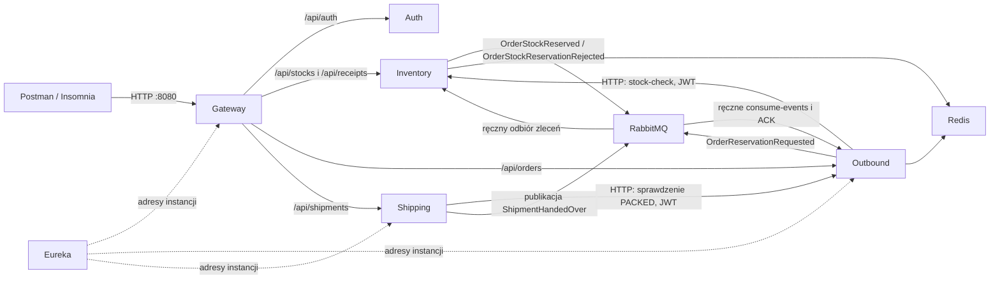

# Ręczne testowanie projektu i komunikacji mikrousług

## Mikrousługi i ich odpowiedzialność

Projekt składa się z czterech mikrousług. Każda działa w osobnym kontenerze i przechowuje dane swojej domeny we własnej bazie SQLite.

| Mikrousługa | Odpowiedzialność | API przez Gateway | Własna baza |
|---|---|---|---|
| **Inventory** | Stany i lokalizacje towarów, przyjęcia dostaw oraz rezerwacje ilości dla zamówień. Przyjęcia są częścią Inventory, nie osobną mikrousługą. | `/api/stocks`, `/api/receipts` | `inventory.db` |
| **Outbound** | Tworzenie i odczyt zamówień, zlecanie rezerwacji przez RabbitMQ, pakowanie oraz zmiana zamówienia na SHIPPED po odebraniu zdarzenia wysyłki. Przechowuje również informacje do deduplikacji zdarzeń. | `/api/orders` | `outbound.db` |
| **Shipping** | Tworzenie przesyłek dla spakowanych zamówień, przygotowanie do wysyłki i wydanie kurierowi. Sprawdza zamówienie przez API Outbound i publikuje zdarzenie `ShipmentHandedOver` do RabbitMQ. | `/api/shipments` | `shipping.db` |
| **Auth** | Konta użytkowników, hashowanie haseł, logowanie, wydawanie tokenów JWT oraz zarządzanie rolami ADMIN, WAREHOUSE i SHIPPING. Pozostałe mikrousługi samodzielnie sprawdzają JWT i wymagane role. | `/api/auth` | `auth.db` |

Usługi komunikują się przez HTTP i zdarzenia, bez bezpośredniego dostępu do cudzych baz. Rezerwacja to **Outbound → RabbitMQ → Inventory → RabbitMQ → Outbound**, z dwoma ręcznymi odbiorami. HTTP pozostaje dla stock-check oraz **Shipping → Outbound** przy sprawdzaniu zamówienia. Wydanie przesyłki to **Shipping → RabbitMQ → Outbound**.

Dodatkowo działają komponenty infrastruktury: **Gateway** udostępnia wspólne wejście HTTP na `127.0.0.1:8080`, **Eureka** przechowuje rejestr adresów usług, **Redis** zapewnia cache, a **RabbitMQ** przekazuje zdarzenia. `init-keys` jest jednorazowym zadaniem przygotowującym klucze JWT.

Instrukcja dotyczy uruchomienia całego systemu przez `compose.yaml`. Żądania HTTP wykonuj w panelu testowym, Swagger UI w przeglądarce albo w Postmanie lub Insomnii. Polecenia `docker compose` uruchamiaj w terminalu, w głównym katalogu projektu. Nie trzeba uruchamiać Pythona ani Mavena na hoście.

## Panel testowy mikroserwisów

Po uruchomieniu Compose otwórz **http://127.0.0.1:8080/** i kliknij **Zaloguj się**. Użyj istniejącego konta. ADMIN ma dostęp do wszystkich funkcji; WAREHOUSE do operacji magazynowych i zamówień, SHIPPING do przesyłek oraz operacji potwierdzania wysyłki. Panel nie blokuje wysyłania żądań z powodu roli lub statusu rekordu — odpowiedź 403 albo 409 jest częścią testu. Token pozostaje tylko w pamięci karty, więc odświeżenie strony wymaga ponownego logowania.

Wybierz mikroserwis w lewym menu, a następnie operację. Kliknięcie rekordu w tabeli uzupełnia identyfikatory; wybory są pamiętane między zakładkami, np. zamówienie z Outbound można wykorzystać przy tworzeniu przesyłki w Shipping. Możesz zmienić metodę, ścieżkę, dowolny JSON, oczekiwany kod HTTP i wyłączyć dołączanie tokenu. **Wyślij żądanie** wykonuje rzeczywiste wywołanie API. Dziennik zawiera status HTTP, czas, nagłówek `X-Cache` oraz żądanie i odpowiedź z ukrytymi hasłami i tokenami. Żądania ograniczono do `/api/…` i `/health` na tym samym Gateway.

Zakładka **Scenariusze** porównuje wyniki poszczególnych kroków z oczekiwaniami:

| Scenariusz | Sprawdzane warunki |
|---|---|
| Najpierw zarezerwuj, potem wyślij | Pakowanie NEW → 409; przesyłka bez PACKED → 409; wydanie przed READY → 409; następnie poprawna rezerwacja, pakowanie, przesyłka, wydanie, publikacja i odbiór zdarzenia RabbitMQ oraz SHIPPED. Ponowna rezerwacja i synchronizacja są idempotentne; druga przesyłka i ponowne wydanie są odrzucane. |
| Towaru nie może zabraknąć | Rezerwacja ponad stan → 409; ilość zero i stan ujemny → 422; rezerwacja całego stanu; zmniejszenie stanu poniżej rezerwacji → 409; dostępność końcowa zero. |
| Zatwierdź przed zaksięgowaniem | Księgowanie NEW → 409; zatwierdzenie i księgowanie → 200; ponowne księgowanie i anulowanie POSTED → 409; stan zwiększony dokładnie raz. |
| Sprawdź granice dostępu | Brak tokenu i błędny token → 401; błędne logowanie → 401; zły format danych → 422; dostęp do usług zgodnie z rolą zalogowanego użytkownika. Uruchom osobno jako ADMIN, WAREHOUSE i SHIPPING. |

Scenariusze magazynowe tworzą nowe dane z unikalnym SKU `UI-…`, dostawcą `Panel testowy` i lokalizacją `UI-TEST`. Dane pozostają w bazach. Scenariusz pełnej wysyłki wymaga ADMIN i RabbitMQ; odbiór zdarzeń może również przetworzyć wcześniejsze wiadomości w kolejce. Test zatrzymuje się na pierwszej niezgodności i pokazuje FAIL ze szczegółami. Czerwony HTTP w ręcznym teście oznacza niezgodność z wybranym oczekiwaniem; oczekiwane 409 albo 422 są wynikiem PASS.

Pliki frontendu znajdują się w `gateway/src/main/resources/static/`. Po ich zmianie wykonaj:

```bash
docker compose build api-gateway
docker compose up -d --no-deps api-gateway
```

Automatyczna weryfikacja w przeglądarce (opcjonalny Playwright na hoście) wykonuje scenariusze i operacje ręczne, sprawdza trzy role, cache, ukrywanie haseł oraz widok mobilny. Tworzy dwa konta testowe i wyłącza je po sprawdzeniu ról. Przygotuj prywatny plik JSON z polami `email` i `password` istniejącego administratora; nie dodawaj go do repozytorium.

```bash
.venv/bin/python -m pip install playwright
.venv/bin/python -m playwright install chromium
.venv/bin/python scripts/verify_frontend.py --credentials-file .local/admin.json
```

Wyniki i zrzuty ekranu są zapisywane w ignorowanym katalogu `reports/frontend/`. Skrypt przyjmuje też `--url`, `--output` oraz `--browser-executable` dla istniejącego Chromium.

## Testowanie w przeglądarce — Swagger UI

Po uruchomieniu Compose otwórz wybraną stronę:

| Mikrousługa | Adres Swagger UI |
|---|---|
| Auth | http://127.0.0.1:8080/docs/auth |
| Inventory | http://127.0.0.1:8080/docs/inventory |
| Outbound | http://127.0.0.1:8080/docs/outbound |
| Shipping | http://127.0.0.1:8080/docs/shipping |

Na stronie Auth rozwiń `POST /auth/login`, kliknij **Try it out**, podaj email i hasło, a następnie kliknij **Execute**. Skopiuj wartość `access_token` z odpowiedzi. Na stronie wybranej mikrousługi kliknij **Authorize** i wklej sam token, bez dopisku `Bearer`. Zatwierdź i zamknij okno. Autoryzację ustaw osobno na każdej stronie.

Teraz możesz wykonywać poniższe scenariusze przyciskami **Try it out → Execute**. W Swaggerze wybierasz ścieżki bez `/api`, np. `/stocks`; ustawiony serwer `/api` dodaje ten prefiks automatycznie. Wszystkie wywołania trafiają przez Gateway na port 8080. Formularze wymagają identyfikatorów rekordów z wcześniejszych odpowiedzi. Endpointy techniczne i wewnętrzna rezerwacja zbiorcza nie są częścią publicznej dokumentacji.

## 1. Uruchomienie i sposób wykonywania żądań

```bash
docker compose up --build -d
docker compose ps -a
```

Oczekiwany stan: osiem usług `healthy`; jednorazowy `init-keys` ma `Exited (0)`. Po pierwszym starcie odczekaj na pobranie wpisów Eureki przez klientów. Zdrowie Gateway nie oznacza jeszcze gotowości wszystkich tras.

W tej instrukcji:

- `BASE` oznacza `http://127.0.0.1:8080`. W Postmanie możesz utworzyć zmienną kolekcji `base_url` i używać `{{base_url}}/api/...`.
- `RECEIPT_ID`, `STOCK_ID`, `ORDER_ID`, `SHIPMENT_ID` zastępuj identyfikatorami z odpowiedzi, bez nawiasów i cudzysłowów w adresie.
- Dla żądań z JSON ustaw `Body → raw → JSON` i `Content-Type: application/json`.
- POST-y zmieniające status, np. `/accept`, `/pack`, `/ready`, wysyłaj **bez body**.
- Oglądaj zarówno JSON, jak i kod HTTP oraz zakładkę nagłówków odpowiedzi.
- Twórz nowe SKU i adresy email przy powtarzaniu testów. Dane testowe pozostają w bazach.

Sprawdź w przeglądarce albo Postmanie:

```http
GET http://127.0.0.1:8080/health
```

Oczekiwane: `200`, `{"service":"API-GATEWAY","status":"ok"}`. Ten endpoint potwierdza działanie samej bramki.

## 2. Logowanie i token

Jeżeli istnieje `.local/lab6-test-admin.json`, odczytaj lokalnie zapisane w nim dane testowego administratora. Nie zakładaj, że plik istnieje na innym komputerze lub po wyczyszczeniu środowiska.

Jeżeli baza Auth jest pusta, utwórz pierwszego administratora:

```bash
docker compose exec auth python scripts/init_auth.py --email admin@example.com --keys-dir /keys/private
```

Skrypt pyta o hasło dwukrotnie. Bootstrap wymaga pustej tabeli użytkowników. Gdy konto już istnieje, zaloguj się jego danymi; nie uruchamiaj ponownie bootstrapu.

```http
POST BASE/api/auth/login
```

```json
{
  "email": "admin@example.com",
  "password": "<własne hasło>"
}
```

Oczekiwane: `200`, `access_token` i `token_type: bearer`. W całej kolekcji ustaw `Authorization → Bearer Token`; wklej `access_token`. Pozostałe żądania powinny dziedziczyć tę autoryzację. Token jest ważny 900 sekund. Przy `401 Invalid or expired token` zaloguj się ponownie i zastąp token.

```http
GET BASE/api/auth/me
```

Oczekiwane: `200`, rola `ADMIN`, `is_active: true`. Administrator może wykonać cały poniższy proces.

## 3. Która usługa z kim rozmawia



Każda usługa ma własną bazę SQLite na osobnym wolumenie. Usługi nie czytają cudzych tabel. Auth wystawia JWT; Inventory, Outbound i Shipping sprawdzają podpis lokalnie kluczem publicznym. Nie wywołują Auth przy każdym żądaniu.

Gateway rozpoznaje trasę i pobiera instancję usługi z lokalnej kopii rejestru Eureki. Usuwa początkowe `/api` i dodaje `X-Gateway: lab4`. Outbound odnajduje Inventory, a Shipping odnajduje Outbound przez klientów Eureki.

## 4. Pełny proces: przyjęcie → zamówienie → wysyłka

### 4.1. Przyjęcie towaru — Inventory

```http
POST BASE/api/receipts
```

```json
{
  "supplier": "Dostawca manualny",
  "items": [
    {
      "sku": "MANUAL-001",
      "quantity_received": 10,
      "target_location": "A-01"
    }
  ]
}
```

Oczekiwane: `201`, status `NEW`. Zapisz `id` jako `RECEIPT_ID`.

| Żądanie | Oczekiwany wynik |
|---|---|
| `POST BASE/api/receipts/RECEIPT_ID/accept` | `200`, `ACCEPTED` |
| `POST BASE/api/receipts/RECEIPT_ID/post` | `200`, `POSTED`; towar trafia do stanów |
| `GET BASE/api/stocks` | `200`; znajdź `MANUAL-001`, ilość 10 |

Zapisz `id` znalezionego stanu jako `STOCK_ID`. Kolejny przebieg wykonaj z nowym SKU, np. `MANUAL-002`.

### 4.2. Cache i zapis

Wykonaj dwa razy, w odstępie krótszym niż 60 sekund:

```http
GET BASE/api/stocks/STOCK_ID
```

Oczekiwane: `200`, `X-Gateway: lab4`. Pierwszy odczyt szczegółów: `X-Cache: MISS`, drugi: `HIT`. Jeśli wcześniej odczytywano ten rekord, pierwszy może już być `HIT`; użyj świeżo utworzonego towaru.

```http
PATCH BASE/api/stocks/STOCK_ID
```

```json
{"quantity": 12}
```

Oczekiwane: `200`, ilość 12. Następny GET szczegółów ma `MISS` i ilość 12; kolejny `HIT`. Zapis unieważnia poprzednią kopię w Redis. Przywróć ilość do 10 tym samym PATCH-em, aby dalsze przykłady liczbowe były zgodne.

### 4.3. Synchroniczne wywołanie Outbound → Inventory

```http
GET BASE/api/orders/stock-check/STOCK_ID
```

Oczekiwane: `200`, obiekt `stock` i `available_quantity: 10`.

Przepływ: klient → Gateway → Outbound → wyszukanie `INVENTORY-SERVICE` → HTTP do Inventory → odpowiedź przez Outbound i Gateway. To nie jest odczyt bazy Inventory przez Outbound.

### 4.4. Walidacja i reguły biznesowe

| Próba | Body | Oczekiwany wynik |
|---|---|---|
| `PATCH /api/stocks/STOCK_ID` | `{"quantity":-1}` | `422`, ilość bez zmiany |
| `GET /api/stocks/invalid-uuid` | — | `422`, niepoprawny UUID |
| `GET /api/stocks/11111111-1111-4111-8111-111111111111` | — | `404`, jeśli taki rekord nie istnieje |
| `POST /api/stocks/STOCK_ID/reservations` | JSON poniżej | `409`, za mało dostępnego towaru |

```json
{
  "order_id": "22222222-2222-4222-8222-222222222222",
  "quantity": 999
}
```

Po nieudanych operacjach odczytaj stan: ilość i rezerwacje powinny pozostać bez zmian.

### 4.5. Zamówienie — Outbound

```http
POST BASE/api/orders
```

```json
{
  "recipient_name": "Jan Testowy",
  "recipient_phone": "123456789",
  "recipient_address": "Testowa 1, Warszawa",
  "items": [
    {"sku": "MANUAL-001", "quantity": 2}
  ]
}
```

Oczekiwane: `201`, `NEW`. Zapisz `id` jako `ORDER_ID`.

| Żądanie | Oczekiwany wynik i komunikacja |
|---|---|
| `POST /api/orders/ORDER_ID/pack` przed rezerwacją | `409`, nie można pakować NEW |
| `POST /api/orders/ORDER_ID/reserve` | `202`, `RESERVATION_PENDING`; zlecenie trafia do RabbitMQ |
| `POST /api/reservations/consume-events` | `200`; Inventory wykonuje Allocation i publikuje wynik |
| `GET /api/orders/ORDER_ID` przed odbiorem wyniku | Nadal `RESERVATION_PENDING`; pakowanie daje 409 |
| `POST /api/orders/consume-reservation-events` | `200`; wynik zmienia status na `RESERVED` albo `RESERVATION_REJECTED` |
| `GET /api/orders/stock-check/STOCK_ID` | `200`, `available_quantity: 8` |
| `POST /api/orders/ORDER_ID/pack` | `200`, `PACKED`; zapis lokalny w Outbound |
| Dwa razy `GET /api/orders/ORDER_ID` | `200`, `PACKED`, cache `MISS → HIT` |

Rezerwacja nie zmniejsza pola `quantity`: nadal wynosi ono 10. Dostępność wynosi 8 po odebraniu zlecenia przez Inventory. Odbiory są ręczne; panel ma przyciski „Odbierz zlecenia rezerwacji” w Inventory i „Odbierz wyniki rezerwacji” w Outbound. Powtórzenie PENDING zachowuje ID próby, a RESERVED nie tworzy drugiej rezerwacji. Po odmowie `/reserve` tworzy nową próbę; powód jest w `reservation_error`. Po awarii brokera użyj Outbound `/orders/{id}/sync-reservation` albo Inventory `/reservations/sync-events`. Odbiór wyników wymaga WAREHOUSE/ADMIN, dotychczasowy odbiór wysyłki nadal SHIPPING/ADMIN.

Wariant zamiast pakowania: gdy inne zamówienie ma RESERVED, wybierz **Outbound → Anuluj zamówienie** (`POST /api/orders/{id}/cancel`), potem **Inventory → Odbierz anulowania zamówień** (`POST /api/reservations/consume-cancellation-events`). Obie operacje wymagają WAREHOUSE/ADMIN. Zamówienie ma CANCELLED od pierwszego kroku, ale rezerwacja znika dopiero po drugim. Przy stanie 10 i rezerwacji 2 fizyczna ilość nadal wynosi 10, a dostępność rośnie z 8 do 10. `reservation_batches` zachowuje wpis RELEASED.

Anulowanie przed RESERVED lub po PACKED daje 409. Powtórzenie CANCELLED i duplikat wiadomości są bezpieczne. Gdy publikacja zwróci 503, zamówienie może już mieć CANCELLED; po powrocie RabbitMQ kliknij **Ponów wysłanie anulowania** (`POST /api/orders/{id}/sync-cancellation`) i odbierz wiadomość w Inventory. Nie ma ponawiania w tle. Przed aktualizacją istniejącej bazy Inventory wykonaj najnowszą migrację `migrate_inventory_cancellations.py` według README.

### 4.6. Przesyłka — Shipping → Outbound

```http
POST BASE/api/shipments
```

```json
{
  "order_id": "<rzeczywisty ORDER_ID>",
  "destination_address": "Warszawa, Testowa 1",
  "courier_id": "22222222-2222-4222-8222-222222222222",
  "weight_kg": 1.5
}
```

Oczekiwane: `201`, `NEW`. Shipping wywołuje Outbound przez HTTP i sprawdza, czy zamówienie ma `PACKED`. Dla niespakowanego zamówienia oczekuj `409`. Zapisz identyfikator przesyłki jako `SHIPMENT_ID`.

| Żądanie | Oczekiwany wynik |
|---|---|
| `POST /api/shipments/SHIPMENT_ID/hand-over` przed READY | `409` |
| `POST /api/shipments/SHIPMENT_ID/ready` | `200`, `READY`; ponowne sprawdzenie zamówienia w Outbound |
| `POST /api/shipments/SHIPMENT_ID/hand-over` | `200`, `HANDED_OVER`, ustawione `handed_over_at`, `notification_pending: false` |

### 4.7. Asynchroniczny etap Shipping → RabbitMQ → Outbound i Inventory

Natychmiast po `/hand-over`:

```http
GET BASE/api/orders/ORDER_ID
```

Zamówienie nadal ma **PACKED**. `notification_pending: false` oznacza udaną publikację, a nie przetworzenie wiadomości przez Outbound. Odbiór jest uruchamiany ręcznie.

Sprawdź kolejkę:

```bash
docker compose exec rabbitmq rabbitmqctl list_queues name messages_ready messages_unacknowledged
```

W izolowanym teście `outbound.shipment-events` i `inventory.shipment-events` powinny mieć po jednej gotowej wiadomości. Jeśli są wiadomości z wcześniejszych testów, liczba może być większa. Każda usługa odbiera własną kopię.

```http
POST BASE/api/orders/consume-events
```

Oczekiwane w izolowanym teście:

```json
{"consumed_messages": 1, "unique_events_processed": 1}
```

Teraz GET zamówienia zwraca `SHIPPED` i `X-Cache: MISS`; kolejny odczyt daje `HIT`. Kolejka Outbound jest pusta, ale Inventory nadal ma swoją wiadomość: ilość fizyczna wynosi 10, a rezerwacja 2 jest aktywna.

W Inventory jako WAREHOUSE/ADMIN wykonaj ręcznie:

```http
POST BASE/api/reservations/consume-shipment-events
```

Panel ma przycisk **Inventory → Odbierz wydania przesyłek**. Po odbiorze GET stanu pokazuje `quantity: 8` i brak rezerwacji tego zamówienia. Dostępność nadal wynosi 8. W bazie `reservation_batches` zachowuje wpis ze statusem CONSUMED. Odbiory Inventory i Outbound można wykonać w dowolnej kolejności. Powtórny odbiór pustej kolejki zwraca zera, duplikat nie odejmuje ponownie. Powtórny `/hand-over` zwraca `409`.

Pusty ponowny odbiór potwierdza opróżnienie kolejki, ale sam nie dowodzi deduplikacji. Deduplikację osobno sprawdzają testy integracyjne przez ponowne wysłanie tego samego `event_id`; oczekiwane wtedy: jedna odebrana wiadomość, zero unikalnych przetworzeń.

Przy aktualizacji istniejącego Inventory najpierw wykonaj `scripts/migrate_inventory_cancellations.py` według README; obejmuje również wcześniejsze zmiany rozchodu. Nowa kolejka nie odtwarza zdarzeń opublikowanych przed jej utworzeniem. Brak pełnej rezerwacji daje 409 i pozostawia wiadomość w kolejce. Przy błędzie cache po zapisie bazy odbiór może dać 503; po naprawie Redis ponów ten sam odbiór, aby usunąć cache i potwierdzić wiadomość bez drugiego rozchodu.

## 5. Logowanie i role

| Próba | Oczekiwane |
|---|---|
| `GET /api/stocks` bez nagłówka Authorization | `401` |
| To samo z `Authorization: Bearer invalid` | `401` |
| Logowanie z błędnym hasłem | `401` |
| Żądanie z wygasłym tokenem | `401`; ponowne logowanie przywraca dostęp |

Jako ADMIN utwórz konto:

```http
POST BASE/api/auth/users
```

```json
{
  "email": "shipping-manual@example.com",
  "password": "ManualTest-Haslo-123!",
  "role": "SHIPPING"
}
```

Zaloguj się na to konto i użyj jego tokenu w osobnym folderze/kolekcji:

| Żądanie z tokenem SHIPPING | Oczekiwane |
|---|---|
| `GET /api/auth/me` | `200`, SHIPPING |
| `GET /api/shipments/SHIPMENT_ID` | `200` |
| `GET /api/stocks` | `403` |
| `POST /api/auth/users` z poprawnym body nowego konta | `403` |

Wróć do tokenu ADMIN przed dalszymi eksperymentami. Opcjonalnie utwórz konto WAREHOUSE: powinno mieć dostęp do stanów i zwykłych operacji zamówień, ale `403` dla przesyłek oraz `/api/orders/consume-events`.

## 6. Jak przeprowadzać próby awarii

Zatrzymuj **jedną usługę naraz**. Przed kolejną próbą przywróć poprzednią i sprawdź jej działanie. Używaj `stop` i `start`, aby zachować kontener i dane. Zatrzymanie usługi nie zatrzymuje automatycznie jej klientów — `depends_on` steruje startem, nie realizuje kaskadowego wyłączania.

W drugim terminalu obserwuj logi:

```bash
docker compose logs -f --tail=40 api-gateway inventory outbound shipping auth
```

Przygotuj dodatkowe zamówienia, aby testy nie kolidowały z wcześniejszym SHIPPED:

- `ORDER_NEW_ID`: nowe zamówienie w stanie NEW.
- `ORDER_RESERVED_ID`: inne zamówienie już zarezerwowane, ale niespakowane.
- `ORDER_PACKED_ID`: kolejne zamówienie PACKED, z przesyłką `SHIPMENT_READY_ID` w READY.
- Do awarii RabbitMQ przygotuj osobną przesyłkę READY i zapisz jej identyfikator jako `SHIPMENT_RABBIT_ID`, a zamówienia jako `ORDER_RABBIT_ID`.

Zapewnij wystarczający stan: każde nowe zamówienie rezerwuje kolejne sztuki. Możesz utworzyć osobny towar w ilości 100 do eksperymentów awarii.

### Ważne: błąd Gateway i błąd domenowy to różne przypadki

Bezpośrednia trasa do zatrzymanej usługi może zwrócić **500** przy próbie połączenia do adresu zachowanego w rejestrze albo **503**, gdy klient nie ma dostępnej instancji. Rejestry i load balancer odświeżają się z opóźnieniem. Nie oczekuj wyłącznie 503 w każdej chwili.

W sprawdzonym środowisku natychmiast po `stop` bezpośrednie trasy zwracały 500. Wywołanie działającego Outbound do niedostępnego Inventory zwracało kontrolowane `503` z `detail: Inventory Service is unavailable`. `/health` Gateway może nadal dawać 200, mimo że konkretna trasa biznesowa nie działa.

## 7. Awaria Inventory

```bash
docker compose stop inventory
```

| Próba | Oczekiwana obserwacja |
|---|---|
| `GET /api/stocks/STOCK_ID` | Błąd Gateway: 500 lub 503 |
| `GET /api/receipts/RECEIPT_ID` | Błąd Gateway: ta sama niedostępna usługa |
| `GET /api/orders/ORDER_NEW_ID` | `200`: Outbound czyta własną bazę/cache |
| `POST /api/orders/ORDER_NEW_ID/reserve` | `202`, RESERVATION_PENDING: zlecenie czeka w RabbitMQ na powrót Inventory |
| `GET /api/orders/stock-check/STOCK_ID` | `503`: niedostępne Inventory |
| `GET /api/auth/me` | `200` |
| `GET /api/shipments/SHIPMENT_READY_ID` | `200`: Shipping odczytuje własną bazę |

Pakowanie już RESERVED jest operacją lokalną Outbound i nie wymaga ponownej rezerwacji w Inventory. Sam Redis nie umożliwia klientowi odczytu stanu przez niedziałające Inventory: żądanie musi trafić do procesu tej usługi.

```bash
docker compose start inventory
docker compose ps
```

Po przywróceniu ponów GET stanu i `stock-check`. Odbierz zlecenie przez Inventory `/reservations/consume-events`, potem wynik przez Outbound `/orders/consume-reservation-events`. W razie opóźnienia rejestru odczekaj i ponów żądanie.

## 8. Awaria Outbound

```bash
docker compose stop outbound
```

| Próba | Oczekiwana obserwacja |
|---|---|
| `GET /api/orders/ORDER_PACKED_ID` | Błąd Gateway: 500 lub 503 |
| `GET /api/stocks/STOCK_ID` | `200` |
| `GET /api/auth/me` | `200` |
| `GET /api/shipments/SHIPMENT_READY_ID` | `200`, odczyt lokalny Shipping |
| `POST /api/shipments/SHIPMENT_READY_ID/hand-over` | `503`: Shipping nie sprawdzi PACKED w Outbound |
| Utworzenie nowej przesyłki dla zamówienia | Nie powiedzie się bez sprawdzenia Outbound |

Nowych zdarzeń nie da się odebrać przez `/api/orders/consume-events`, ponieważ endpoint należy do zatrzymanego Outbound. Już opublikowane wiadomości mogą czekać w RabbitMQ. Wydanie READY również wymaga Outbound, więc nie każda operacja Shipping jest niezależna od niego.

```bash
docker compose start outbound
```

Po przywróceniu sprawdź odczyt zamówienia. Jeśli chcesz dokończyć wydanie przesyłki, ponów `/hand-over`, potem `/consume-events`.

## 9. Awaria Shipping

```bash
docker compose stop shipping
```

| Próba | Oczekiwana obserwacja |
|---|---|
| `GET /api/shipments/SHIPMENT_READY_ID` | Błąd Gateway: 500 lub 503 |
| `GET /api/stocks/STOCK_ID` | `200` |
| `GET /api/orders/ORDER_RESERVED_ID` | `200` |
| `POST /api/orders/ORDER_RESERVED_ID/pack` | `200`, PACKED; Shipping nie jest potrzebny do pakowania |
| `GET /api/auth/me` | `200` |

Outbound może odebrać wcześniej opublikowane zdarzenia, jeśli RabbitMQ i Redis działają. Bez Shipping nie utworzysz ani nie wydasz nowej przesyłki.

```bash
docker compose start shipping
```

## 10. Awaria Auth

Zaloguj się **przed** zatrzymaniem Auth i zachowaj ważny token ADMIN.

```bash
docker compose stop auth
```

| Próba | Oczekiwana obserwacja |
|---|---|
| `POST /api/auth/login` | Błąd Gateway: nowe logowanie niedostępne |
| `GET /api/auth/me` | Błąd Gateway: endpoint jest w Auth |
| `GET /api/stocks/STOCK_ID` z ważnym tokenem | `200` |
| `GET /api/orders/ORDER_PACKED_ID` z ważnym tokenem | `200` |
| `GET /api/shipments/SHIPMENT_READY_ID` z ważnym tokenem | `200` |

Pozostałe usługi znają klucz publiczny i weryfikują JWT lokalnie. Po wygaśnięciu tokenu zwrócą `401`, a nowego nie uzyskasz do czasu powrotu Auth. Dezaktywacja konta jest sprawdzana przez Auth przy logowaniu i `/auth/me`; pozostałe usługi nie mają centralnej listy unieważnionych tokenów.

```bash
docker compose start auth
```

## 11. Awaria Redis

```bash
docker compose stop redis
```

| Próba | Oczekiwana obserwacja |
|---|---|
| `GET /api/stocks/STOCK_ID` | `200`, `X-Cache: BYPASS`, dane z SQLite |
| `GET /api/orders/ORDER_PACKED_ID` | `200`, `X-Cache: BYPASS` |
| PATCH ilości stanu poprawnym JSON-em | `200`, zapis do SQLite mimo nieudanego unieważnienia cache |
| `GET /api/auth/me` | `200`; Auth nie potrzebuje Redis |

Sprawdź gotowość Inventory bez wystawiania jego portu:

```bash
docker compose exec inventory python -c "import urllib.request; print(urllib.request.urlopen('http://127.0.0.1:8101/ready').read().decode())"
```

Oczekiwane: HTTP 200, `status: degraded`, `cache: down`, baza `ok`. Awaria opcjonalnego cache nie powoduje wyłączenia HTTP. Shipping również raportuje ten adapter w `/ready`, chociaż operacje przesyłek nie używają cache.

**Szczególny przypadek odbioru zdarzeń:** `consume-events` wymaga udanego unieważnienia cache przed ACK. Przy niedostępnym Redis może zatwierdzić SHIPPED w bazie, a następnie zwrócić `503 Cache invalidation failed; event remains queued`. Wiadomość zostaje do ponowienia. Nie oznacza to wycofania zmiany w bazie. Po powrocie Redis ponów odbiór; deduplikacja zapobiegnie ponownemu skutkowi zdarzenia. Ten mechanizm wynika z obsługi zdarzeń w `OrderService.consume_events`.

```bash
docker compose start redis
```

Przywrócony Redis może zawierać stare wpisy, jeśli podczas awarii nie udało się ich usunąć. Odczyt może być nieaktualny do TTL 60 s. Poczekaj na wygaśnięcie lub wykonaj ponownie udany zapis unieważniający konkretny klucz. Nie czyść całego Redis na komputerze — może należeć do innego projektu.

## 12. Awaria RabbitMQ i naprawa publikacji

Użyj nowej przesyłki `SHIPMENT_RABBIT_ID` w READY, której zamówienie `ORDER_RABBIT_ID` ma PACKED.

```bash
docker compose stop rabbitmq
```

1. GET stanu, zamówienia i `/api/auth/me` powinny nadal zwracać `200`.
2. Wykonaj `POST /api/shipments/SHIPMENT_RABBIT_ID/hand-over`.
3. Oczekuj `503 RabbitMQ broker is unavailable`.
4. Wykonaj `GET /api/shipments/SHIPMENT_RABBIT_ID`.
5. Oczekuj **HANDED_OVER**, ustawionego czasu wydania i **`notification_pending: true`**.
6. `POST /api/orders/consume-events` również zwróci `503`.

Istotna obserwacja: odpowiedź 503 nie oznacza tutaj braku zapisu. Shipping zapisał fakt wydania przed próbą publikacji. Zamówienie pozostaje PACKED, dopóki zdarzenie nie zostanie skutecznie dostarczone i odebrane.

Przywróć broker:

```bash
docker compose start rabbitmq
docker compose ps
```

Po osiągnięciu `healthy`:

| Żądanie | Oczekiwane |
|---|---|
| `POST /api/shipments/SHIPMENT_RABBIT_ID/sync` | `200`, HANDED_OVER, `notification_pending: false` |
| `POST /api/orders/consume-events` | Przetworzenie oczekującego zdarzenia |
| `GET /api/orders/ORDER_RABBIT_ID` | `200`, SHIPPED |

Po awarii publikacji używaj **`/sync`**, a nie ponownego `/hand-over`: przesyłka została już wydana, więc ponowne wydanie zwróci 409. Ponowienia `/sync` wymagają ręcznego wywołania; nie działa tu automatyczny proces naprawy w tle.

Przy rezerwacji awaria publikacji daje 503, ale zamówienie zostaje RESERVATION_PENDING z `reservation_notification_pending=true`. Po powrocie brokera wywołaj `/orders/{id}/sync-reservation`, odbiór zleceń Inventory i odbiór wyników Outbound. Jeśli Inventory zapisało wynik, lecz nie mogło go wysłać, użyj `/reservations/sync-events`. Każde ponowienie zachowuje tę samą próbę i nie rezerwuje ponownie.

## 13. Awaria Eureki

Najpierw wykonaj poprawny odczyt stanu, zamówienia i `stock-check`, aby klienci mieli pobrany rejestr.

```bash
docker compose stop eureka
```

Ponów GET-y stanu, zamówienia, przesyłki, `/api/auth/me` i `stock-check`.

W krótkiej próbie na już działającym systemie komunikacja może **nadal działać**: Gateway, Outbound i Shipping przechowują lokalne kopie adresów. Eureka nie pośredniczy w każdym żądaniu HTTP. W logach pojawiają się błędy odświeżania rejestru i heartbeatów.

To nie dowodzi niezależności od rejestru w każdej sytuacji. Nowe/reutworzone instancje mogą nie zostać odnalezione, zmienione adresy nie będą odświeżane, a rozruch bez Eureki nie ma gwarancji powodzenia. Nie restartuj pozostałych usług podczas tej próby, jeśli chcesz badać wyłącznie utratę działającego rejestru. Zależności `service_healthy` dodatkowo blokują start usług uruchamianych przez pełne `up`, jeśli Eureka nie jest gotowa.

```bash
docker compose start eureka
```

Po powrocie sprawdź wpisy:

```bash
docker compose exec eureka wget -qO- http://127.0.0.1:8761/eureka/apps
```

Oczekiwane cztery nazwy: `INVENTORY-SERVICE`, `OUTBOUND-SERVICE`, `SHIPPING-SERVICE`, `AUTH-SERVICE`, ze statusem UP po ponownej rejestracji. Odświeżanie odbywa się okresowo.

## 14. Awaria Gateway

```bash
docker compose stop api-gateway
```

`BASE/health` i wszystkie żądania biznesowe z hosta nie uzyskają odpowiedzi HTTP: klient pokaże błąd połączenia. To inny przypadek niż HTTP 500/503 z działającej bramki.

Pozostałe kontenery powinny nadal działać:

```bash
docker compose ps -a
docker compose exec inventory python -c "import urllib.request; print(urllib.request.urlopen('http://127.0.0.1:8101/health').read().decode())"
docker compose exec outbound python -c "import urllib.request; print(urllib.request.urlopen('http://127.0.0.1:8102/health').read().decode())"
docker compose exec shipping python -c "import urllib.request; print(urllib.request.urlopen('http://127.0.0.1:8103/health').read().decode())"
docker compose exec auth python -c "import urllib.request; print(urllib.request.urlopen('http://127.0.0.1:8104/health').read().decode())"
```

Oczekiwane: cztery odpowiedzi `status: ok`. To diagnostyka wewnątrz kontenerów, nie obejście opublikowanych tras. Gateway jest jedynym wejściem HTTP z hosta, więc jego awaria odcina klienta od działających usług.

```bash
docker compose start api-gateway
```

Po powrocie ponów `/health` i odczyty biznesowe.

## 15. Zestawienie wpływu awarii

| Niedostępny komponent | Co przestaje działać | Co pozostaje dostępne przy ważnym JWT |
|---|---|---|
| Inventory | Stany, przyjęcia, wykonanie rezerwacji i stock-check | Zlecenie rezerwacji czekające w RabbitMQ, lokalne operacje Outbound, odczyty Shipping, Auth |
| Outbound | Zamówienia, odbiór zdarzeń, sprawdzanie zamówienia przy operacjach Shipping | Inventory, Auth, lokalne odczyty Shipping |
| Shipping | API przesyłek i publikacja nowych wydań | Inventory, Outbound, Auth; odbiór już opublikowanych zdarzeń |
| Auth | Logowanie, zarządzanie kontami, `/auth/me` | Operacje innych usług do wygaśnięcia JWT |
| Redis | Cache; pełne potwierdzenie odbioru zdarzenia może się nie udać | Odczyty SQLite z BYPASS, zwykłe zapisy, Auth, Shipping |
| RabbitMQ | Publikacja i odbiór zdarzeń | Zwykłe operacje HTTP; wydanie zapisuje się jako oczekujące publikacji |
| Eureka | Odświeżanie adresów i rejestracja | Krótkotrwała komunikacja istniejących klientów z pobranym rejestrem |
| Gateway | Całe wejście HTTP z hosta | Procesy usług i ich wewnętrzne endpointy diagnostyczne |

## 16. Trwałość danych i restart jednej usługi

Zapisz identyfikatory towaru, przyjęcia, zamówienia i przesyłki. Sprawdź ich aktualne stany, następnie:

```bash
docker compose down
docker compose up -d --wait --wait-timeout 180
```

Ponów odczyty przez Gateway. Oczekiwane:

- te same rekordy i statusy, np. POSTED, SHIPPED, HANDED_OVER;
- zachowane konta oraz klucze — dotychczasowy JWT działa, jeśli jeszcze nie wygasł;
- pierwszy GET szczegółów stanu i zamówienia daje MISS, ponieważ Redis nie zapisuje cache na trwałym wolumenie;
- wszystkie usługi powracają do healthy; ewentualne początkowe błędy tras należy ponowić po odświeżeniu rejestru.

Następnie:

```bash
docker compose restart inventory
```

Po powrocie Inventory ponów `GET /api/stocks/STOCK_ID` i `GET /api/orders/stock-check/STOCK_ID`. Oba powinny działać bez restartowania innych usług.

Nie stosuj `docker compose down -v` w teście trwałości: opcja `-v` usuwa bazy, wiadomości i klucze z wolumenów tego projektu.

## 17. Izolacja portów

Wejście z hosta:

```text
http://127.0.0.1:8080/health
```

Powinno działać. Bezpośrednie adresy usług:

```text
http://127.0.0.1:8101/health
http://127.0.0.1:8102/health
http://127.0.0.1:8103/health
http://127.0.0.1:8104/health
```

Powinny odrzucać połączenie. `docker compose ps` powinno pokazywać wyłącznie mapowanie Gateway `127.0.0.1:8080->8080/tcp`. Zapis `8101-8104/tcp` bez strzałki to porty obrazu, nie publikacja na hoście. Redis działający niezależnie na hoście nie jest dowodem wystawienia Redis tego projektu.

## 18. Zakończenie i zbieranie dowodów

Przywróć wszystkie komponenty:

```bash
docker compose up -d --wait --wait-timeout 180
docker compose ps -a
```

Do każdej próby zapisz: żądanie, kod HTTP, istotny JSON, nagłówki X-Gateway/X-Cache oraz stan kontenerów. Nie zapisuj haseł i tokenów w publicznym raporcie. Przy błędzie obejrzyj logi usługi docelowej, jej klienta i Gateway.

Po skończonej demonstracji możesz pozostawić system działający lub zatrzymać go z zachowaniem danych:

```bash
docker compose down
```


## 19. Zaobserwowane wyniki prób awarii

Próby wykonano 24.11.2026 na uruchomionym środowisku Compose, przed zmianą rezerwacji na RabbitMQ. Wiersz Inventory opisuje historyczną rezerwację HTTP; aktualne oczekiwania są w sekcji 7. Każdy komponent zatrzymywano osobno, sprawdzano odpowiedzi i przywracano przed kolejną próbą. Wyniki krótkiej próby zależą od momentu odświeżenia rejestru; nie zastępują długotrwałych testów dostępności.

| Zatrzymany komponent | Rzeczywisty wynik |
|---|---|
| Inventory | Bezpośredni odczyt przez Gateway: 500; stock-check i nowa rezerwacja w Outbound: 503; odczyt zamówienia, przesyłki i konta: 200 |
| Outbound | Odczyt zamówienia: 500; wydanie READY przez Shipping: 503; Inventory, Auth i odczyt przesyłki: 200 |
| Shipping | Odczyt przesyłki: 500; pakowanie RESERVED przez Outbound: 200; Inventory i Auth: 200 |
| Auth | Logowanie i /auth/me: 500; stany, zamówienie i przesyłka z wcześniej wydanym JWT: 200 |
| Redis | Odczyty stanu i zamówienia: 200/BYPASS; PATCH stanu: 200 i poprawny odczyt nowej ilości z bazy; /ready Inventory: degraded, cache down |
| RabbitMQ | /hand-over: 503, lecz zapisane HANDED_OVER i notification_pending=true; odbiór: 503; po starcie brokera /sync i /consume-events: 200, zamówienie SHIPPED |
| Eureka | W tej krótkiej próbie wszystkie cztery trasy oraz stock-check nadal zwracały 200 dzięki pobranym wcześniej adresom |
| Gateway | Żądania z hosta: błąd połączenia; /health wszystkich czterech mikrousług wewnątrz kontenerów: status ok |

Przypadek błędu unieważnienia cache podczas odbioru zdarzenia w sekcji 11 opisano na podstawie implementacji; nie był częścią powyższej próby awarii Redis.
