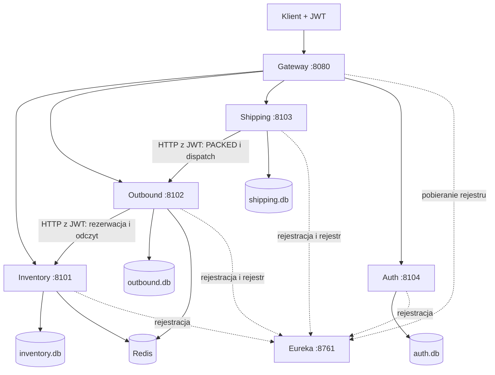
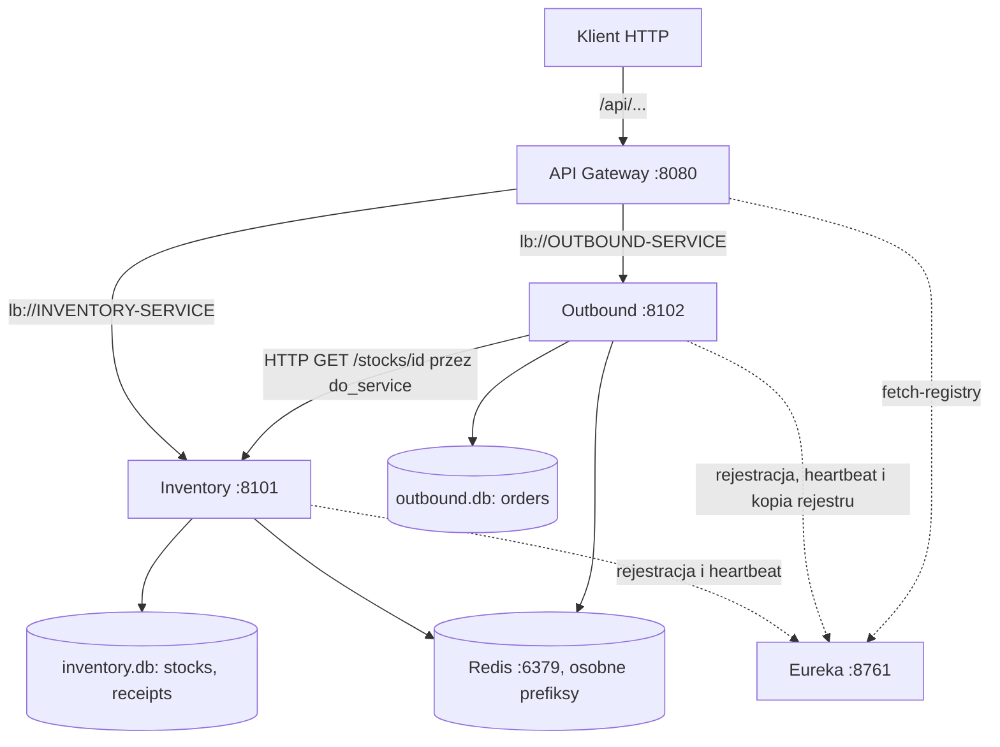

# System magazynowy — Inventory, Outbound, Shipping i Auth

## Aktualny stan — cztery mikrousługi

Zaimplementowane są **Inventory, Outbound, Shipping i Auth**. Każda usługa działa jako osobny proces i posiada własną bazę SQLite. Inbound (przyjęcia dostaw) pozostaje modułem Inventory. Wszystkie usługi rejestrują się w Eurece, a Gateway udostępnia ich API pod `/api/...`.

| Usługa | Plik startowy | Port | Baza / tabele | Odpowiedzialność |
|---|---|---|---|---|
| Inventory | `app/inventory.py` | 8101 | `inventory.db`: stocks, receipts, reservation_batches | Stany, przyjęcia, rezerwacje |
| Outbound | `app/outbound.py` | 8102 | `outbound.db`: orders, order_dispatches | Zamówienia, rezerwowanie przez Inventory, pakowanie i potwierdzanie wysyłki |
| Shipping | `app/shipping.py` | 8103 | `shipping.db`: shipments | Przesyłki, przygotowanie, wydanie kurierowi i powiadomienie Outbound |
| Auth | `app/auth.py` | 8104 | `auth.db`: users | Konta, Argon2id, logowanie, JWT RS256 i role |

Gateway działa na :8080, Eureka na :8761, a Redis domyślnie na :6379. Auth nie korzysta z Redis. Shipping zapisuje i czyta przesyłki bez cache; wspólna fabryka inicjalizuje adapter Redis i uwzględnia go w `/ready`, lecz jego awaria nie blokuje operacji na przesyłkach.



### Konta, JWT i role

Auth przechowuje wyłącznie hashe Argon2id. JWT zawiera identyfikator użytkownika, rolę, wystawcę, odbiorcę, czasy ważności i identyfikator tokenu; nie zawiera hasła. Tylko Auth podpisuje token kluczem prywatnym RSA. Inventory, Outbound i Shipping znają klucz publiczny i sprawdzają podpis RS256, issuer, audience oraz exp/iat/nbf. Algorytm jest ustalony w kodzie, nie pobierany z niezaufanego nagłówka tokenu. Domyślny czas ważności to 900 s, konfigurowalny od 1 do 3600 s.

| Rola | Uprawnienia |
|---|---|
| ADMIN | Wszystkie operacje, tworzenie kont i aktywowanie/dezaktywowanie użytkowników |
| WAREHOUSE | Inventory i zwykłe operacje Outbound: zamówienia, rezerwowanie, pakowanie |
| SHIPPING | Shipping oraz wąskie endpointy Outbound `/orders/{id}/shipping-check` i `/orders/{id}/dispatch` |

Gateway zachowuje domyślny timeout odpowiedzi 5 s, a trasa Shipping ma `metadata.response-timeout: 10000` (10 s). Wydanie kurierowi wykonuje dwa kolejne wywołania Outbound z timeoutem 3 s, więc wymaga większego budżetu niż pojedynczy odczyt. Testy HTTP mają limit 15 s.

Brak lub błędny token daje 401; niewłaściwa rola 403. Kontrola działa również na bezpośrednich portach usług. `/health`, `/ready` i dokumentacja pozostają technicznie dostępne lokalnie. Auth sprawdza aktywność konta przy logowaniu i `/auth/me`, a także aktualną rolę administratora przy zarządzaniu kontami. Pozostałe usługi weryfikują JWT lokalnie: dezaktywowanie konta nie unieważnia natychmiast jego już wydanego tokenu, który może działać do `exp`. Zatrzymanie Auth nie blokuje operacji z ważnym tokenem. Nie dodano refresh tokenów, centralnej listy unieważnień ani limitowania prób logowania.

Kontrola JWT jest domyślnie włączona we wspólnej fabryce (także `app.main:app`). Jawne `auth_enabled=False` w testach izoluje historyczne scenariusze biznesowe od uwierzytelniania; oddzielne testy sprawdzają zabezpieczenia z prawdziwymi podpisami. Nie ma zmiennej środowiskowej wyłączającej ochronę. Auth zawsze wymaga uwierzytelniania swoich chronionych operacji. Brak klucza publicznego przy włączonej ochronie przerywa start usługi; nie ma automatycznego przejścia w tryb bez ochrony.

### Przygotowanie i uruchomienie wszystkich usług

Z głównego katalogu repozytorium przygotuj zależności (Python 3.12+, JDK 21 i Maven 3.9.x):

```bash
bash scripts/setup.sh --setup-only --test
mvn -f eureka-server/pom.xml package
mvn -f gateway/pom.xml package
.venv/bin/python scripts/init_auth.py --email admin@example.com
```

Na Windows zamiast pierwszego polecenia użyj `powershell -NoProfile -ExecutionPolicy Bypass -File .\scripts\setup.ps1 -SetupOnly -Test`; zamiast `.venv/bin/python` używaj `.\.venv\Scripts\python.exe`.

`init_auth.py` pyta dwukrotnie o hasło (12–128 znaków), tworzy lokalną parę RSA 2048 w `.local/` i pierwszego administratora w `auth.db`. Hasło nie jest argumentem procesu i nie trafia do repozytorium. Nie ma domyślnego hasła. Skrypt odmawia utworzenia kolejnego administratora startowego, gdy tabela użytkowników zawiera już konto, oraz nie nadpisuje kluczy. Kolejne konta tworzy administrator przez API. Nie usuwaj bazy ani kluczy przy zwykłym restarcie.

Uruchom kolejno, w osobnych terminalach z głównego katalogu projektu:

```bash
# 1. Redis — opcjonalnie własny lokalny serwer zamiast Compose
docker compose up -d redis

# 2. Eureka
mvn -f eureka-server/pom.xml spring-boot:run

# 3. Auth
.venv/bin/python -m uvicorn app.auth:app --host 127.0.0.1 --port 8104

# 4. Inventory
.venv/bin/python -m uvicorn app.inventory:app --host 127.0.0.1 --port 8101

# 5. Outbound
.venv/bin/python -m uvicorn app.outbound:app --host 127.0.0.1 --port 8102

# 6. Shipping
.venv/bin/python -m uvicorn app.shipping:app --host 127.0.0.1 --port 8103

# 7. Gateway
mvn -f gateway/pom.xml spring-boot:run
```

Nie trzeba ustawiać `SERVICE_PORT` przy domyślnych portach powyżej. Jeżeli ta zmienna pozostała ustawiona w terminalu z wcześniejszego etapu, usuń ją (`unset SERVICE_PORT` w Bash; `Remove-Item Env:SERVICE_PORT -ErrorAction SilentlyContinue` w PowerShell) lub ustaw właściwą wartość dla danego procesu. Przy niestandardowym `--port` ustaw również odpowiadający mu `SERVICE_PORT`, aby Eureka zgłaszała właściwy adres.

| Zmienna | Domyślnie |
|---|---|
| DATABASE_URL / OUTBOUND_DATABASE_URL | `sqlite:///./inventory.db` / `sqlite:///./outbound.db` |
| SHIPPING_DATABASE_URL / AUTH_DATABASE_URL | `sqlite:///./shipping.db` / `sqlite:///./auth.db` |
| JWT_PRIVATE_KEY_FILE | `.local/jwt-private.pem` — potrzebny wyłącznie Auth |
| JWT_PUBLIC_KEY_FILE | `.local/jwt-public.pem` — publiczny klucz weryfikacji |
| JWT_ISSUER / JWT_AUDIENCE | `warehouse-auth` / `warehouse-api` — muszą być zgodne we wszystkich usługach |
| JWT_TTL_SECONDS | 900 — używane w Auth |
| EUREKA_SERVER_URL | `http://127.0.0.1:8761` |
| GATEWAY_EUREKA_URL | `http://127.0.0.1:8761/eureka/` |
| REDIS_URL | `redis://127.0.0.1:6379/0` |
| CACHE_PREFIX / CACHE_TTL_SECONDS | `lab2:local:warehouse` / 60 |

`.env.example` nie jest wczytywany automatycznie. Ustaw zmienne w terminalach, jeżeli zmieniasz domyślne wartości. Pliki SQLite pozostają w katalogu roboczym; nowe tabele pomocnicze w istniejących bazach Inventory i Outbound tworzą się przy starcie, bez zmiany dotychczasowych kolumn i bez kasowania danych. Każdy proces tworzy tylko własne tabele.

Poczekaj na cztery wpisy UP w Eurece i odświeżenie lokalnych rejestrów Gateway, Outbound oraz Shipping. Pierwsze wywołania zależności mogą zwracać kontrolowane 503, zanim zakończy się discovery. Interaktywne dokumentacje są na `/docs` portów 8101–8104. W Swaggerze Auth wykonaj `/auth/login`, skopiuj `access_token`, a następnie w wybranej usłudze użyj przycisku **Authorize** i wklej sam token.

Zatrzymanie: Ctrl+C w terminalach Gateway, Shipping, Outbound, Inventory, Auth i Eureka; dla własnego Redis z Compose: `docker compose stop redis`. Pozostaw bazy i klucze na dysku.

### Endpointy nowych usług i przepływ realizacji zamówienia

Poniżej ścieżki widziane przez klienta Gateway (:8080); `StripPrefix=1` usuwa `/api`. Bezpośrednie porty usług używają ścieżek bez `/api`.

| Metoda i ścieżka | Działanie | Rola |
|---|---|---|
| POST `/api/auth/login` | Email i hasło → access_token, token_type | Publiczne logowanie |
| GET `/api/auth/me` | Profil aktywnego użytkownika, bez hasha | Każda zalogowana rola |
| POST `/api/auth/users` | Konto: email, password, role; sukces 201 | ADMIN |
| PATCH `/api/auth/users/{id}` | `{"is_active":false}` lub true; ostatni aktywny administrator nie może zostać wyłączony | ADMIN |
| POST `/api/orders/{id}/reserve` | Rezerwacja wszystkich pozycji przez Inventory i status RESERVED | WAREHOUSE, ADMIN |
| POST `/api/orders/{id}/pack` | RESERVED → PACKED | WAREHOUSE, ADMIN |
| POST `/api/shipments` | order_id, carrier, weight_kg; nowe NEW, sukces 201 | SHIPPING, ADMIN |
| GET `/api/shipments`, GET `/api/shipments/{id}` | Lista i szczegóły przesyłek | SHIPPING, ADMIN |
| POST `/api/shipments/{id}/ready` | NEW → READY; sprawdza PACKED w Outbound | SHIPPING, ADMIN |
| POST `/api/shipments/{id}/hand-over` | READY → HANDED_OVER, czas UTC i powiadomienie Outbound | SHIPPING, ADMIN |
| POST `/api/shipments/{id}/cancel` | NEW/READY → CANCELLED | SHIPPING, ADMIN |
| POST `/api/shipments/{id}/sync` | Ponowienie oczekującego powiadomienia o wysyłce | SHIPPING, ADMIN |

Shipping rejestruje przesyłkę wyłącznie dla istniejącego zamówienia PACKED i ponownie sprawdza stan przed przygotowaniem oraz wydaniem. Outbound udostępnia Shipping bezpośredni odczyt bazy (`/orders/{id}/shipping-check`), aby decyzja nie opierała się na potencjalnie starej kopii Redis. Powiadomienie `POST /orders/{id}/dispatch` zmienia PACKED → SHIPPED, zapisuje identyfikator przesyłki i unieważnia cache zamówienia. Ponowienie z tym samym shipment_id jest idempotentne, a inne shipment_id daje 409. Te dwa wąskie endpointy mają rolę SHIPPING/ADMIN; WAREHOUSE nie może sam oznaczyć zamówienia jako wysłanego.

Przykłady JSON:

```json
{"email":"pracownik@example.com","password":"haslo-co-najmniej-12-znakow","role":"WAREHOUSE"}
```

```json
{"order_id":"UUID-spakowanego-zamowienia","carrier":"Firma kurierska","weight_kg":2.5}
```

Każde żądanie domenowe wymaga `Authorization: Bearer <access_token>`. Gateway przekazuje ten nagłówek, a wywołania Outbound → Inventory i Shipping → Outbound zachowują token użytkownika oraz `Content-Type: application/json` przy wysyłaniu JSON. Bramka nie sprawdza reguł biznesowych i nie łączy się z bazami.

Przykładowa kolejność przez Gateway: zaloguj administratora, utwórz pracownika WAREHOUSE i SHIPPING, utwórz zamówienie, wykonaj `/reserve`, `/pack`, utwórz przesyłkę, wykonaj `/ready` i `/hand-over`. Stan zamówienia kończy się na SHIPPED, przesyłki na HANDED_OVER.

Rezerwacja zbiorcza Inventory (`POST /reservations`, tylko port Inventory) obejmuje wszystkie SKU i lokalizacje w jednej transakcji. Brak towaru daje 409 i rollback całej operacji. Zapisuje żądanie według order_id, więc utracona odpowiedź lub ponowienie po błędzie zapisu Outbound nie rezerwuje towaru drugi raz. Zmienione pozycje pod tym samym order_id dają 409. Outbound nadaje RESERVED dopiero po poprawnym potwierdzeniu. Nie dodano zewnętrznej trasy `/api/reservations`; klient korzysta z operacji na zamówieniu.

Wydanie kurierowi i wpis `notification_pending=true` są jedną transakcją Shipping. Potem usługa próbuje powiadomić Outbound. Jeżeli powiadomienie się nie powiedzie lub odpowiedź zostanie utracona, przesyłka pozostaje HANDED_OVER i odpowiedź zawiera `notification_pending=true`; nie cofamy zapisanego faktu wydania. Po przywróceniu połączenia wywołaj `/sync` z ważnym tokenem. Udane potwierdzenie ustawia false. To trwałe ponowienie sterowane API, bez brokera i bez automatycznego procesu w tle; stan oczekujący przetrwa restart.

Ograniczenia: jedna przesyłka na zamówienie, także po jej anulowaniu; brak etykiet i numerów śledzenia. Rezerwacje po wysyłce pozostają zapisane w Inventory — nie dodano fizycznego rozchodu towaru ani zwalniania rezerwacji. Nie ma transakcji obejmującej dwie bazy; dlatego jawnie obsługujemy ponowienia i stan oczekującego powiadomienia. Nie dodano paczkomatów ani integracji z przewoźnikiem.

### Testy nowych usług

Wynik końcowej weryfikacji (19.11.2026): **101 testów jednostkowych i komponentowych oraz 11 integracyjnych przeszło**. Gateway zbudował się poprawnie, `pip check` nie wykazał niespójnych zależności. Cztery usługi zarejestrowały się w Eurece jako UP. Potwierdzono trwałość kont i przesyłek po restartach oraz działanie ważnego JWT przy zatrzymanym Auth. [Raport rzeczywistego wykonania](verification/services.json) dotyczy niezależnego środowiska na portach 18080, 18101–18104 i 18761.

```bash
# Szybkie testy: SQLite, prawdziwe podpisy RSA, atrapy Redis i discovery
.venv/bin/python -m pytest -q
.venv/bin/python -m pip check

# Prawdziwy system już działa; GATEWAY_TOKEN to token administratora
export GATEWAY_TOKEN='<access_token>'
.venv/bin/python -m pytest -o addopts= tests/integration -q

# Weryfikacja na własnych tymczasowych bazach i procesach, Debian/WSL:
.venv/bin/python scripts/verify_services.py
```

W PowerShell token ustaw przez `$env:GATEWAY_TOKEN = '<access_token>'`. Testy integracyjne tworzą własne unikalne SKU, zamówienia i konta; nie kasują baz użytkownika. Wymagają wszystkich czterech usług i sprawnego Redis. Skrypt `verify_services.py` wymaga zbudowanych JAR-ów, `redis-server` i Java 21 w PATH (opcjonalnie `--java /ścieżka/bin/java`). Sprawdza wolne porty 8080/8101–8104/8761, uruchamia własne siedem procesów, tworzy klucze i administratora tylko w katalogu tymczasowym, wykonuje integracje oraz restarty Shipping i Auth. Nie zatrzymuje procesów użytkownika ani nie czyści współdzielonego cache. Wynik zapisuje w `verification/services.json`. Jeżeli standardowe porty są zajęte, dodaj `--port-offset 10000`: testy użyją 18080, 18101–18104 i 18761, bez zatrzymywania istniejących procesów.

Nowe testy obejmują: hashe i brak haseł w odpowiedziach/walidacji, aktywność kont, unikalność emaila, role na bezpośrednich portach, JWT o złym podpisie/algorytmie/wystawcy/odbiorcy/czasie, atomowość rezerwacji, legalne przejścia statusów przesyłki, awarie zależności i utratę odpowiedzi po zatwierdzonym dispatch. W integracjach poprzednie siedem scenariuszy bramki działa z JWT, a cztery nowe sprawdzają Auth, role oraz pełny przepływ wysyłki.

Oficjalne źródła: [PyJWT — podpisy RSA i walidacja claims](https://pyjwt.readthedocs.io/en/stable/usage.html), użyte PyJWT 2.15.1; [argon2-cffi — PasswordHasher](https://argon2-cffi.readthedocs.io/en/stable/howto.html), użyte 25.1.0. Ich zastosowanie sprawdzono testami błędnych tokenów i logowania oraz rzeczywistym wywołaniem HTTP między usługami. Implementację i testy przygotował Codex na polecenie użytkownika; nie przypisujemy autorom projektu niepotwierdzonego udziału w tych zmianach.

## Dokumentacja historycznych etapów

Poniższe sekcje zachowują opis LAB1–LAB4 sprzed wdrożenia Shipping i Auth. Występujące w nich określenia „planowane” i przykłady bez JWT dotyczą tamtego stanu projektu. Do aktualnego uruchomienia stosuj instrukcję powyżej.

## Uruchomienie i testy — historyczny tryb LAB1/LAB2

Wymagania: Python 3.12 lub nowszy i internet do pobrania zależności. Skopiuj projekt na nowy komputer bez katalogu `.venv`. Otwórz terminal w katalogu z tym README.

### Windows 11

Zainstaluj Python 3.12 lub nowszy z [python.org](https://www.python.org/downloads/windows/), wraz z pip i launcherem `py`, i otwórz nowy PowerShell.

```powershell
powershell -NoProfile -ExecutionPolicy Bypass -File .\scripts\setup.ps1
```

`Bypass` dotyczy tylko uruchamianego procesu i nie zmienia trwale polityki PowerShell.

### Debian 13

```bash
sudo apt update
sudo apt install python3 python3-venv
bash scripts/setup.sh
```

Skrypty tworzą lokalne `.venv`, instalują `requirements.txt` i uruchamiają aplikację bez `--reload`. Ponowne uruchomienie korzysta z istniejącego środowiska. Nie trzeba go aktywować. Przeniesione lub uszkodzone `.venv` należy usunąć i odtworzyć skryptem.

| Opcja | Windows | Debian |
|---|---|---|
| Samo przygotowanie środowiska | `-SetupOnly` | `--setup-only` |
| Testy przed uruchomieniem | `-Test` | `--test` |
| Inny port | `-Port 8200` | `--port 8200` |

Opcje można łączyć, np. `bash scripts/setup.sh --setup-only --test`. Na Windows dopisz je po ścieżce do skryptu, np. `powershell -NoProfile -ExecutionPolicy Bypass -File .\scripts\setup.ps1 -SetupOnly -Test`. Błąd instalacji lub testów przerywa uruchamianie.

Domyślnie API działa pod `http://127.0.0.1:8101`, status pod `/health`, a dokumentacja pod `/docs`. Serwer jest dostępny lokalnie; zatrzymanie: `Ctrl+C`.

Uruchomienie obejmuje tylko Inventory i Outbound. Shipping i Auth nie mają jeszcze kodu, baz ani osobnych procesów; obecne endpointy nie wymagają logowania.

### Uruchomienie ręczne (Windows)

```powershell
python -m venv .venv
.\.venv\Scripts\python.exe -m pip install -r requirements.txt
.\.venv\Scripts\python.exe -m pytest -q
.\.venv\Scripts\python.exe -m uvicorn app.main:app --reload --port 8101
```

W drugim terminalu: `Invoke-RestMethod http://localhost:8101/health`. Dokumentacja: [Swagger UI](http://localhost:8101/docs). Zatrzymanie serwera: `Ctrl+C`. Nie trzeba aktywować środowiska. Zmień `replace-me` w aplikacji i teście na nazwę usługi.

## Struktura kodu

Poniższe pliki dotyczą zaimplementowanych domen Inventory i Outbound. Pliki Shipping i Auth powstaną w kolejnym etapie.

- `app/main.py` — inicjalizacja baz, serwisów i rejestracja routerów.
- `app/models/order.py` — modele zamówień i walidacja danych.
- `app/models/stock.py` — model stanu i walidacja rezerwacji.
- `app/models/receipt.py` — modele przyjęcia i pozycji dostawy.
- `app/routers/` — endpointy: `health.py`, `stocks.py`, `receipts.py`, `orders.py`.
- `app/services/orders.py` — operacje na zamówieniach i reguła pakowania.
- `app/services/stocks.py` — odczyt stanów i kontrola dostępności przy rezerwacji.
- `app/services/receipts.py` — operacje przyjęć i unieważnianie cache zmienionych stanów po księgowaniu.
- `app/repositories.py` — transakcje, reguły biznesowe i zapis obu domen; przyjęcia należą do Inventory.
- `app/db_models.py` — tabele `stocks`, `receipts` i `orders`.
- `tests/conftest.py` — wspólny klient ze świeżą aplikacją dla każdego testu.
- `tests/test_*.py` — scenariusze health, Inventory i Outbound.

## 1. Problem i granice

Inventory pomaga pracownikowi magazynu kontrolować ilość i dostępność towaru. Odpowiada za stany, lokalizacje, rezerwacje i przyjęcia dostaw wraz z danymi dostawcy; nie obsługuje kompletacji ani wysyłki.

Planowany Auth będzie uwierzytelniać pracowników i zarządzać ich rolami. Auth wydaje token, a każda usługa sprawdza uprawnienia do swoich operacji. Konta i hasła należą wyłącznie do Auth.

Pojęcia: **SKU** — kod produktu; **lokalizacja** — miejsce składowania; **rezerwacja** — towar przydzielony zamówieniu; **dostępność** — ilość pomniejszona o rezerwacje; **przyjęcie** — dostawa księgowana na stan Inventory.

| Usługa i etap | Odpowiedzialność | Własne dane | Operacje | Docelowo potrzebne informacje od innej usługi |
|---|---|---|---|---|
| Inventory (z przyjęciami), zaimplementowane | Stany, rezerwacje i dostawy | `Stock`, `Receipt` | Odczyt, korekta, rezerwacja, rejestracja i księgowanie przyjęć | Identyfikator zamówienia z Outbound; tożsamość i rola z tokenu Auth |
| Outbound, zaimplementowane | Realizacja zamówień | `Order` | Przyjęcie zamówienia, kompletacja, pakowanie | Dostępność i potwierdzenie rezerwacji z Inventory; tożsamość i rola z tokenu Auth |
| Shipping, planowane | Wysyłka paczek | `Shipment` | Rejestracja przesyłki, wydanie kurierowi | Potwierdzenie spakowania z Outbound; tożsamość i rola z tokenu Auth |
| Auth, planowana czwarta usługa | Konta, logowanie i role | `User` | Tworzenie kont przez administratora, logowanie, wydawanie JWT, odczyt własnego profilu | Nie wymaga danych magazynowych ani zamówień |

Każda usługa zapisuje własne dane: Inventory — stany, rezerwacje i przyjęcia, Outbound — zamówienia, docelowo Shipping — przesyłki, a Auth — konta i role. Księgowanie przyjęcia zmienia stany wewnętrznie, w tej samej transakcji Inventory; zmiany danych innej usługi wymagają API. Inventory, Outbound i Shipping nie zapisują haseł ani nie modyfikują bazy Auth.

Przyszłe HTTP: **Outbound → Inventory**, `POST /stocks/{id}/reservations`, żądanie `{"order_id":"22222222-2222-4222-8222-222222222222","quantity":3}`, odpowiedź `201` z utworzoną rezerwacją. Przy niedostępności Inventory zamówienie pozostaje `NEW`, bez potwierdzenia rezerwacji. Integracja HTTP nie jest jeszcze zaimplementowana.

## 2. Model i reguła biznesowa

### Inventory — `Stock`

`Stock`: `id` — UUID nadawany przez serwer; `sku` i `location` — wymagane, niepuste teksty; `quantity` — wymagana liczba całkowita ≥ 0; `reservations` — lista, początkowo pusta. Każda rezerwacja ma wymagane `order_id` (UUID) i `quantity` (liczba całkowita > 0).

**Reguła:** suma rezerwacji nie może przekraczać stanu. Przy 10 sztukach i 7 zarezerwowanych można zarezerwować kolejne 3, ale nie 4 (`409 Conflict`). Wszystkie warunki odrzucenia sprawdzamy przed zmianą danych.

Para `(sku, location)` jest unikalna w bazie Inventory.

### Inventory — `Receipt` (moduł przyjęć)

`Receipt`: `id` — UUID serwera; `supplier` — niepusty tekst; `status` — początkowo `NEW`; `items` — niepusta lista pozycji: `sku`, `target_location` (niepuste teksty), `quantity_received` (liczba całkowita > 0).

**Reguła:** `NEW → ACCEPTED → POSTED`. Księgowanie dodaje ilości do stanów według SKU i lokalizacji albo tworzy brakujące stany. Cała dostawa i status `POSTED` są zapisywane w jednej transakcji; istniejące rezerwacje pozostają bez zmian. Powtórne księgowanie daje `409`. Anulowanie do `CANCELLED` jest dozwolone tylko z `NEW` lub `ACCEPTED`.

### Outbound — `Order`

`Order`: `id` — UUID serwera; `recipient_name`, `recipient_phone`, `recipient_address` — niepuste teksty; `status` — początkowo `NEW`; `items` — niepusta lista pozycji: `sku` (niepusty tekst), `quantity` (liczba całkowita > 0).

**Reguła:** tylko zamówienie z potwierdzoną rezerwacją (`RESERVED`) można oznaczyć jako spakowane (`PACKED`). Niedozwolona operacja zwraca `409` bez zmiany danych.

### Shipping — `Shipment` (planowana usługa)

`Shipment`: `id` — UUID serwera; `order_id` — UUID zamówienia; `carrier` — niepusty tekst; `weight_kg` — liczba > 0; `status` — początkowo `NEW`; `handed_over_at` — data i godzina wydania, początkowo brak.

**Reguła:** tylko przesyłkę `READY` można wydać kurierowi; otrzymuje wtedy status `HANDED_OVER` i czas wydania. Niedozwolona operacja zwraca `409` bez zmiany danych.

### Auth — `User` (planowana czwarta usługa)

`User`: `id` — UUID serwera; `email` — wymagany poprawny i unikalny adres; `password_hash` — hash hasła, np. Argon2id; `role` — `ADMIN`, `WAREHOUSE` lub `SHIPPING`; `is_active` — wartość logiczna, początkowo `true`. Utworzenie konta przyjmuje hasło, a odpowiedź z profilem nie zawiera hasła ani jego hasha.

**Reguła:** tylko `ADMIN` może tworzyć konta (`201`); próba wykonania tej operacji przez `WAREHOUSE` lub `SHIPPING` daje `403`, bez zapisu użytkownika. Logowanie wymaga poprawnego hasła i aktywnego konta; w przeciwnym razie zwraca `401` bez wydania tokenu. Są to wymagania planowane, jeszcze niezaimplementowane.

## 3. Kontrakt API

Kontrakt API:

| Metoda | Ścieżka | Znaczenie | Sukces | Błędy |
|---|---|---|---|---|
| GET | `/health` | Status i nazwa usługi | 200 | — |
| GET | `/stocks` | Lista stanów | 200 | — |
| GET | `/stocks/{id}` | Szczegóły stanu | 200 | 404, 422 |
| POST | `/stocks/{id}/reservations` | Rezerwacja towaru | 201 | 404, 409, 422 |

Przykłady (`{id}` oznacza UUID):

- `GET /health` → `200`, `{"status":"ok","service":"replace-me"}`.
- `GET /stocks` przy pustym magazynie → `200`, `[]`.
- `GET /stocks/{id}` dla istniejącego stanu → `200`, `{"id":"11111111-1111-4111-8111-111111111111","sku":"SKU-001","location":"A-01","quantity":10,"reservations":[]}`.
- `POST /stocks/{id}/reservations`, JSON `{"order_id":"22222222-2222-4222-8222-222222222222","quantity":3}` → `201` z takim samym JSON-em utworzonej rezerwacji.
- Odczyt nieistniejącego UUID → `404`, `{"detail":"Stock not found"}`.
- Rezerwacja 11 z 10 dostępnych sztuk → `409`, `{"detail":"Insufficient available stock"}`.
- Rezerwacja z `quantity: 0` → `422`, np.:

```json
{"detail":[{"type":"greater_than","loc":["body","quantity"],"msg":"Input should be greater than 0","input":0,"ctx":{"gt":0}}]}
```

`200` oznacza odczyt, `201` utworzenie rezerwacji, `404` brak zasobu, `409` konflikt z dostępnością, `422` błędne dane. Reguła: rezerwacja nie przekracza dostępnego stanu; odrzucenie nie zmienia danych. `detail` w `HTTPException` jest tutaj tekstem, a przy walidacji FastAPI — listą błędów.

### Przyjęcia w Inventory

| Metoda | Ścieżka | Znaczenie | Sukces | Błędy |
|---|---|---|---|---|
| POST | `/receipts` | Utworzenie przyjęcia `NEW` | 201 | 422, 503 |
| GET | `/receipts` | Lista przyjęć | 200 | 503 |
| GET | `/receipts/{id}` | Szczegóły przyjęcia | 200 | 404, 422, 503 |
| POST | `/receipts/{id}/accept` | Zatwierdzenie `NEW → ACCEPTED` | 200 | 404, 409, 422, 503 |
| POST | `/receipts/{id}/post` | Księgowanie `ACCEPTED → POSTED` i aktualizacja stanów | 200 | 404, 409, 422, 503 |
| POST | `/receipts/{id}/cancel` | Anulowanie `NEW` lub `ACCEPTED` | 200 | 404, 409, 422, 503 |

Przykład `POST /receipts`:

```json
{"supplier":"Dostawca ABC","items":[{"sku":"SKU-001","quantity_received":5,"target_location":"A-01"}]}
```

Odpowiedź zawiera te same dane oraz UUID `id` i `status: "NEW"`. Zwrócony UUID podstaw pod `{id}`, następnie wywołaj `/accept` i `/post` (bez treści żądania). Stan 10 wzrośnie do 15 dopiero po `/post`. Powtarzające się SKU i lokalizacja w pozycjach są sumowane. Odczyty przyjęć korzystają bezpośrednio z bazy.

Brak przyjęcia: `404`, `{"detail":"Receipt not found"}`. Księgowanie przed zatwierdzeniem, ponowne księgowanie albo księgowanie po anulowaniu: `409`, `{"detail":"Only ACCEPTED receipts can be posted"}`. Anulowanie zaksięgowanego przyjęcia daje `409`; nie odejmuje towaru od stanu.

### Auth — planowany kontrakt (jeszcze niedostępny)

| Metoda | Ścieżka | Znaczenie | Sukces | Błędy |
|---|---|---|---|---|
| POST | `/auth/login` | Logowanie aktywnego użytkownika i wydanie JWT | 200 | 401, 422 |
| GET | `/auth/me` | Własny profil po uwierzytelnieniu | 200 | 401 |
| POST | `/auth/users` | Utworzenie konta przez `ADMIN` | 201 | 401, 403, 409, 422 |

Przykładowe przyszłe logowanie:

```json
{"email":"pracownik@example.com","password":"przykladowe-haslo"}
```

Odpowiedź: `200`, `{"access_token":"<JWT>","token_type":"bearer"}`. Klient dołącza `Authorization: Bearer <JWT>` do żądań. Usługi lokalnie sprawdzają podpis, wystawcę, odbiorcę i czas ważności tokenu oraz rolę wymaganą przez endpoint; nie wywołują Auth przy każdym żądaniu. Hasło nie jest umieszczane w tokenie.

Administrator utworzy konto przez `/auth/users`, przekazując `email`, `password` i `role`; odpowiedź zawiera UUID, email, rolę i `is_active`. `409` oznacza zajęty email. `401` oznacza błędne logowanie albo brak poprawnego tokenu, a `403` — poprawny token bez wymaganych uprawnień. Planowane przykłady: `{"detail":"Invalid credentials"}` i `{"detail":"Insufficient permissions"}`. Obecne Inventory i Outbound nie weryfikują jeszcze tokenów; te endpointy Auth nie pojawiają się obecnie w Swaggerze.

## 4. Testy i stan danych

Poniższa tabela i wynik 22 testów dokumentują LAB1. Aktualny zestaw obejmuje też SQLite, Redis i przyjęcia; jego wynik znajduje się w punkcie 10.

Testy Inventory i Outbound sprawdzają zapis i odczyt oraz odrzucanie operacji bez zmiany danych: `404` dla brakującego zasobu, `409` dla braku dostępności lub pakowania bez rezerwacji, `422` dla błędnych UUID i ilości. Każdy test używa nowego `create_app()`. Początkowo jest produkt `SKU-001`, lokalizacja `A-01`, ilość 10, bez rezerwacji. Zamówienia są początkowo puste; integracja potwierdzająca rezerwację z Inventory pozostaje do implementacji.

`S` — UUID tego stanu; `O1` — `22222222-2222-4222-8222-222222222222`, `O2` — `33333333-3333-4333-8333-333333333333`. W żądaniach podstawiamy te UUID.

| Scenariusz | Stan początkowy i dokładne żądanie | Oczekiwany status, treść i stan | Wynik rzeczywisty | Reset danych |
|---|---|---|---|---|
| Health | `GET /health` | `200`, `{"status":"ok","service":"replace-me"}` | Zgodny | `create_app()` |
| Lista i szczegóły | Stan początkowy; `GET /stocks`, `GET /stocks/S` | `200`, jeden produkt i jego szczegóły, ilość 10 | Zgodny | `create_app()` |
| Zapis → odczyt | Stan początkowy; `POST /stocks/S/reservations`, `{"order_id":"O1","quantity":3}`, potem `GET /stocks/S` | `201`, JSON rezerwacji; odczyt `200`, rezerwacja 3, ilość 10 | Zgodny | `create_app()` |
| Brak zasobu | `GET /stocks/99999999-9999-4999-8999-999999999999` | `404`, `{"detail":"Stock not found"}` | Zgodny | `create_app()` |
| Błędne dane | Stan początkowy; POST jak wyżej, `{"order_id":"O1","quantity":0}`, potem odczyt | `422`, błąd pola `quantity`; stan bez zmian | Zgodny | `create_app()` |
| Konflikt | Zarezerwowane 7; POST jak wyżej, `{"order_id":"O2","quantity":4}`, potem odczyt | `409`, `Insufficient available stock`; nadal tylko rezerwacja 7 | Zgodny | `create_app()` |
| Reguła biznesowa | Stan początkowy; POST rezerwacji O1 na 7, następnie O2 na 4 | `201`, potem `409`; ilość 10, zarezerwowane 7 | Zgodny | `create_app()` |
| Restart | Rezerwacja 3 i odczyt przez HTTP; restart Uvicorna; odczyt listy i starego S | Przed restartem rezerwacja 3; po restarcie produkt z nowym UUID, ilość 10, brak rezerwacji; stary S daje `404` | Zgodny | Restart procesu |

Wynik `.\.venv\Scripts\python.exe -m pytest -q`: **22 passed** (Inventory, Outbound i health).

Eksperyment HTTP wykonano bez `--reload` i zmian kodu. Rezerwacja przetrwała kolejne żądania, ale zniknęła po restarcie: dane są w pamięci procesu, a `create_app()` odtwarza produkt początkowy.

Planowane testy Auth: poprawne logowanie i odczyt `/auth/me`, odrzucenie błędnego hasła lub nieaktywnego konta (`401`), odrzucenie nieważnego tokenu (`401`), utworzenie konta przez `ADMIN` oraz odmowa dla innej roli (`403`) bez zmiany danych. Testy i ich wyniki powstaną razem z implementacją Auth; nie są wliczone do obecnego zestawu. Shipping również nie jest jeszcze testowany.

## 5. Porównanie architektur

```text
Monolit:
[1 proces: Inventory (stany + przyjęcia) + Outbound + Shipping + Auth] -> [wspólna baza]

Modularny monolit (strzałki wewnątrz = wywołania funkcji):
[1 proces: Inventory (stany + przyjęcia) <- Outbound <- Shipping; Auth: konta i role]
    -> [baza: tabele modułów]

Mikrousługi (każda usługa = osobny proces i własna baza):
[Inventory/Stock + Receipt] <--HTTP-- [Outbound/Order] <--HTTP-- [Shipping/Shipment]
[Klient] --HTTP: logowanie--> [Auth/User]
[Klient] --HTTP + JWT--> Inventory / Outbound / Shipping (lokalna weryfikacja tokenu)
```

1. Inventory ma własne dane i API oraz może działać w osobnym procesie; moduł jest częścią aplikacji.
2. W monolicie przyjęcia, stany, zamówienia, wysyłka oraz konta i logowanie działałyby w jednym procesie ze wspólną bazą.
3. Podział daje niezależne wdrażanie, ale dodaje opóźnienia sieci i awarie zależności; brak Inventory blokuje rezerwacje, a brak Auth nowe logowania.
4. Modularny monolit — prostsze wdrażanie i utrzymanie przy małej skali.

Schematy pokazują docelowy system czterech usług. Obecnie działają tylko Inventory i Outbound w jednym procesie; Shipping i Auth nie są zaimplementowane.

## 6. Dokumentacja wykorzystana podczas pracy

| Odnośnik do fragmentu | Rozwiązywany problem | Co zastosowano w kodzie | Jak sprawdzono działanie |
|---|---|---|---|
| [FastAPI — Path operation](https://fastapi.tiangolo.com/tutorial/first-steps/#step-3-create-a-path-operation) | Obsługa żądania GET | `@app.get("/health")` | Test sprawdza `200` i JSON |
| [FastAPI — TestClient](https://fastapi.tiangolo.com/tutorial/testing/#using-testclient) | Testowanie API | `TestClient(create_app())` | `pytest tests/test_health.py`: **1 passed** |
| [OWASP — Access Control i JWT](https://cheatsheetseries.owasp.org/cheatsheets/REST_Security_Cheat_Sheet.html#access-control), [Password Storage](https://cheatsheetseries.owasp.org/cheatsheets/Password_Storage_Cheat_Sheet.html) | Projektowanie logowania i uprawnień Auth | Plan: hash hasła, JWT i kontrola ról w usługach; bez implementacji | Przegląd projektu; testy Auth są dopiero planowane |

## 7. Ograniczenia, autorzy i AI

Dane są trwałe w SQLite. Przyjęcia należą do Inventory; brakuje jeszcze automatycznej integracji Inventory–Outbound, zwalniania rezerwacji i wysyłki. Shipping i Auth są planowane. Obecnie nie ma kont, logowania, wydawania JWT ani kontroli ról w endpointach. Redis może zwracać starą kopię do wygaśnięcia TTL.

- AI: ChatGPT pomógł w testach i endpointach; weryfikacja przez przegląd kodu i test `/health`.

## 8. Podział systemu na usługi

Docelowo: cztery usługi. Inventory i Outbound są zaimplementowane; Shipping i Auth powstaną później.

### Serwis Magazynu i Przyjęć (Inventory)

**Usługa odpowiada za:**
- Przechowywanie ilości i lokalizacji produktów.
- Rezerwowanie towaru dla zamówień.
- Rejestrowanie dostaw, dostawcy, otrzymanych ilości i lokalizacji docelowych.
- Zatwierdzanie, księgowanie i anulowanie przyjęć przed zaksięgowaniem.
- Aktualizowanie stanów przy księgowaniu dostawy i korekcie ilości.

**Usługa nie odpowiada za:**
- Kompletowanie i pakowanie zamówień.
- Obsługę wysyłki paczek.
- Wystawianie dokumentów PZ.

Inbound jest modułem tej usługi, bez osobnego procesu, bazy i integracji HTTP z Inventory.

### Serwis Realizacji Zamówień (Outbound)

**Usługa odpowiada za:**
- Przyjmowanie zamówień i danych odbiorcy.
- Zlecanie rezerwacji towaru w Inventory.
- Tworzenie list kompletacyjnych i potwierdzanie spakowania.

**Usługa nie odpowiada za:**
- Samodzielne zmienianie stanów magazynowych.
- Rejestrowanie dostaw od dostawców.
- Obsługę przekazania paczek kurierowi.

### Serwis Wysyłki i Kurierów (Shipping — planowany)

**Usługa odpowiada za:**
- Rejestrowanie przesyłek dla spakowanych zamówień.
- Zapisywanie przewoźnika i wagi paczki.
- Potwierdzanie przekazania paczki kurierowi i powiadamianie pozostałych usług.

**Usługa nie odpowiada za:**
- Kompletowanie i pakowanie zamówień.
- Zarządzanie stanami magazynowymi.
- Generowanie etykiet i obsługę numerów śledzenia.

### Serwis Kont i Logowania (Auth — planowana czwarta usługa)

**Usługa będzie odpowiadać za:**
- Przechowywanie kont pracowników, hashy haseł, ról i aktywności kont.
- Sprawdzanie danych logowania oraz wydawanie podpisanych JWT z czasem ważności.
- Tworzenie kont przez administratora i udostępnianie własnego profilu.

**Usługa nie będzie odpowiadać za:**
- Zarządzanie towarem, przyjęciami, zamówieniami ani przesyłkami.
- Podejmowanie decyzji biznesowych, np. czy wystarczy towaru na rezerwację.

Planowane role: `ADMIN` — konta i wszystkie operacje; `WAREHOUSE` — Inventory i Outbound; `SHIPPING` — wysyłka. Każda usługa będzie weryfikować token i uprawnienia do własnych endpointów. Auth będzie mieć osobną bazę i docelowo osobny proces; obecnie nie jest uruchamiany.

## 9. Modele danych

Inventory ma dwie tabele we własnej bazie: `stocks` i `receipts`. Outbound ma tabelę `orders` w osobnej bazie. Planowane Shipping i Auth będą mieć własne bazy: odpowiednio z przesyłkami i tabelą `users`. Identyfikatory UUID nadaje serwer. Pola oznaczone `↳` są elementami JSON, a nie osobnymi kolumnami.

### Inventory — tabela `stocks` (model `Stock`)

Jeden rekord opisuje stan produktu w konkretnej lokalizacji.

| Pole | Opis |
|---|---|
| `id` | Identyfikator rekordu |
| `sku` | Kod produktu |
| `location` | Lokalizacja produktu |
| `quantity` | Liczba sztuk, razem z zarezerwowanymi |
| `reservations` | Lista aktywnych rezerwacji — JSON |
| ↳ `order_id` | Identyfikator zamówienia |
| ↳ `quantity` | Liczba zarezerwowanych sztuk |

Lista rezerwacji może być pusta. Dostępny stan to `quantity` pomniejszone o sumę rezerwacji.

### Inventory — tabela `receipts` (model `Receipt`, moduł przyjęć)

Jeden rekord opisuje dostawę wraz z produktami.

| Pole | Opis |
|---|---|
| `id` | Identyfikator przyjęcia |
| `supplier` | Nazwa dostawcy |
| `status` | Etap obsługi dostawy |
| `items` | Lista produktów w dostawie — JSON |
| ↳ `sku` | Kod produktu |
| ↳ `quantity_received` | Otrzymana liczba sztuk |
| ↳ `target_location` | Lokalizacja docelowa |

Statusy:
- `NEW` — nowe przyjęcie
- `ACCEPTED` — przyjęcie zatwierdzone
- `POSTED` — ilości dodane do stanów w tej samej transakcji Inventory
- `CANCELLED` — przyjęcie anulowane

### Outbound — tabela `orders` (model `Order`)

Jeden rekord opisuje zamówienie wraz z odbiorcą i produktami.

| Pole | Opis |
|---|---|
| `id` | Identyfikator zamówienia |
| `recipient_name` | Imię i nazwisko lub nazwa odbiorcy |
| `recipient_phone` | Numer telefonu odbiorcy |
| `recipient_address` | Adres dostawy |
| `status` | Etap realizacji zamówienia |
| `items` | Lista zamówionych produktów — JSON |
| ↳ `sku` | Kod produktu |
| ↳ `quantity` | Zamówiona liczba sztuk |

Statusy:
- `NEW` — nowe zamówienie
- `RESERVED` — towar zarezerwowany
- `PACKED` — zamówienie spakowane
- `SHIPPED` — paczka przekazana kurierowi
- `CANCELLED` — zamówienie anulowane

### Shipping — tabela `Shipment` (planowana)

Jeden rekord opisuje jedną paczkę.

| Pole | Opis |
|---|---|
| `id` | Identyfikator przesyłki |
| `order_id` | Identyfikator zamówienia |
| `carrier` | Firma kurierska |
| `weight_kg` | Waga paczki w kilogramach |
| `status` | Etap wysyłki |
| `handed_over_at` | Data i godzina wydania kurierowi |

Statusy:
- `NEW` — przesyłka zarejestrowana
- `READY` — gotowa do wydania
- `HANDED_OVER` — przekazana kurierowi
- `CANCELLED` — przesyłka anulowana


### Auth — tabela `users`, model `User` (planowane)

Jeden rekord będzie opisywać konto pracownika we własnej bazie `auth.db`.

| Pole | Opis |
|---|---|
| `id` | UUID użytkownika nadawany przez serwer |
| `email` | Wymagany, poprawny i unikalny adres używany jako login |
| `password_hash` | Wymagany hash hasła, np. Argon2id; niewracany w API |
| `role` | Wymagana rola: `ADMIN`, `WAREHOUSE` lub `SHIPPING` |
| `is_active` | Czy konto może się logować; domyślnie `true` |

Planowane modele API: `UserCreate` przyjmuje email, hasło i rolę; `UserRead` zwraca UUID, email, rolę i aktywność, bez hasła i hasha. JWT jest wydawanym po logowaniu tokenem z identyfikatorem użytkownika, rolą i czasem ważności. Tabela i modele Auth jeszcze nie istnieją w kodzie.

## 10. LAB2 — baza danych i cache

Poniższe sekcje opisują SQLite i Redis z LAB2 oraz przyjęcia włączone do Inventory. Historyczna tabela restartu i wynik 22 testów w punkcie 4 dotyczą LAB1; aktualne dane są trwałe, a wynik testów podano poniżej.

### Zmiany i wykorzystany kod pomocniczy

Rozwiązanie oparto na rzeczywiście pobranym [kodzie pomocniczym LAB2 — ZIP](https://pawoom.lazysolutions.pl/2026_2027/lab2/lab2-support.zip), zgodnie z [instrukcją laboratorium](https://pawoom.lazysolutions.pl/2026_2027/lab2/). Oryginalna paczka jest zachowana w [materials/lab2-support.zip](materials/lab2-support.zip). Pobrano 03.11.2026; SHA-256 archiwum:

```text
575fbe27f7bafb582311c35ccc7eb4478921c72c798a72117ce2df4b0361e902
```

| Plik z ZIP-a | Wykorzystanie we własnym projekcie |
|---|---|
| `database.py` | Przeniesiony do `app/database.py` **bez zmian**: `Base`, `make_database()`, fabryka sesji, `PRAGMA foreign_keys=ON` |
| `cache.py` | Przeniesiony do `app/cache.py` **bez zmian**: `JsonCache`, `make_redis()`, TTL, GET/SET/DELETE, timeouty i brak ponowień |
| `demo.py` | Wzorzec sesji i repozytorium dostosowany do `StockRepository` i `OrderRepository`; odczyt cache-aside z `CachedLockers.get` przeniesiony do `cached_read()`; commit przed DEL w serwisach |
| `tests/test_storage.py` | Klasa `MemoryRedis` skopiowana do `tests/fakes.py`; własna podklasa `ControlledRedis` dodaje awarie poszczególnych poleceń, kontrolowany zegar TTL i obserwację zamknięcia klienta |
| `tests/test_storage.py` | Scenariusze trwałości, rollbacku, MISS/HIT z licznikiem odczytów, awarii SET i nieudanego unieważnienia dostosowane do własnego API HTTP |
| `README-LAB2-template.md` | Podstawa struktury niniejszego uzupełnienia: decyzje, uruchomienie, dowody, porównanie, źródła i autorzy |

Paczkomat z `demo.py` służył wyłącznie do zrozumienia mechanizmu repozytorium. Aplikacja obsługuje własną domenę magazynu; nie zawiera tabel ani endpointów paczkomatów. Oryginalny przykład pozostaje jedynie wewnątrz archiwum źródłowego.

Własne rozszerzenia względem paczki: modele ORM magazynu, repozytoria obu domen, walidacja schematu i UUID kopii w `cached_read()`, HTTP i `X-Cache`, `lifespan`, dwie osobne bazy, blokada zapisu SQLite przed sprawdzeniem reguły, korekta ilości, gotowość `/ready` i testy API. W przeciwieństwie do demonstracyjnego `create()` nie mapujemy wszystkich `IntegrityError` na konflikt — tylko rozpoznaną kolizję UUID zamówienia. Pozostałe awarie bazy dają 503.

Zachowano fabrykę `create_app()`, dotychczasowe metody i ścieżki HTTP, format UUID, JSON, walidację, błędy 404/409/422 oraz reguły rezerwacji i pakowania. Zmieniono magazyn w pamięci na SQLite dla **Inventory i Outbound**. Dodano `PATCH /stocks/{id}` do korekty ilości, `X-Cache` na odczytach szczegółów oraz opcjonalny `/ready`. Nazwa `replace-me` w `/health` pozostaje zgodna z kontraktem LAB1.

### Dane, właściciel i transakcje

| Baza i właściciel zapisu | Tabela | Pola i ograniczenia |
|---|---|---|
| Inventory — `inventory.db` | `stocks` | `id` UUID PK; unikalna para `(sku, location)`; `quantity` całkowite ≥ 0; `reservations` JSON z `order_id` UUID i dodatnią ilością |
| Inventory — ta sama baza | `receipts` | `id` UUID PK; wymagany dostawca; dozwolony status; pozycje dostawy w JSON |
| Outbound — `outbound.db` | `orders` | `id` UUID PK; wymagane dane odbiorcy; `status` ograniczony do statusów LAB1; `items` JSON z SKU i dodatnią ilością |

Tabela opisuje obecne bazy. Planowany Auth będzie właścicielem `auth.db` i tabeli `users`; pozostałe usługi nie będą odczytywać jej bezpośrednio. Bazy Shipping i Auth nie są obecnie tworzone, nie dodano ich konfiguracji ani zależności do uruchamianej aplikacji.

`StockRow`, `ReceiptRow` i `OrderRow` korzystają z `Base` pobranego z ZIP-a. Inicjalizacja tworzy wyłącznie tabele właściciela danej bazy: `stocks` i `receipts` w Inventory, `orders` w Outbound. Nowa lista rezerwacji jest przypisywana jako całość, aby ORM wykrył zmianę JSON.

Baza chroni klucz główny, `NOT NULL`, nieujemną ilość, dozwolone statusy oraz unikalną parę SKU–lokalizacja. Pydantic pilnuje tekstów, UUID i ścisłych typów ilości. `order_id` w rezerwacji jest odwołaniem do obcej domeny bez FK między bazami; Inventory nie kopiuje danych odbiorcy ani statusu zamówienia. Outbound nie zapisuje cudzych stanów magazynowych.

`app/main.py` tworzy brakujące tabele przez `Base.metadata.create_all()`. Przy tworzeniu nowej tabeli `stocks` powstaje też indeks `uq_stocks_sku_location`, zadeklarowany w `app/db_models.py`. Nie ma automatycznej migracji istniejących tabel ani dodawania do nich nowych indeksów. Podczas developmentu po zmianie struktury odtwarzamy lokalne bazy od zera; zwykły restart bez usuwania plików zachowuje dane.

Przyjęcie i wszystkie jego pozycje są księgowane w jednej transakcji `BEGIN IMMEDIATE`: istniejące stany są zwiększane, brakujące tworzone, a przyjęcie otrzymuje `POSTED`. Nie zmieniamy rezerwacji. Powtórzone pozycje tej samej pary SKU–lokalizacja są sumowane. Błąd cofa również wcześniejsze zmiany pozycji tej dostawy. Równoczesne próby zaksięgowania tego samego przyjęcia dają jeden sukces i jeden konflikt; nie podwajają dostawy.

Wszystkie listy, szczegóły i operacje zapisu przeniesionych danych korzystają z repozytoriów SQLite; stare słowniki usunięto. Silnik i fabryka sesji powstają raz na aplikację, ale każda operacja otwiera osobną sesję. `with sessions.begin()` z wzorca ZIP zatwierdza **commit** po poprawnym wyjściu, a po wyjątku wykonuje **rollback** i zamyka sesję. Odczyty używają `with sessions()` i również zamykają sesję. `lifespan` przygotowuje zasoby, a `ExitStack` zamyka oba silniki i klienta Redis, także przy błędzie startu. Import modułu nie tworzy plików baz.

W SQLite zapis zaczyna się od `BEGIN IMMEDIATE` przed odczytem dostępności. Dzięki temu konkurencyjny zapis z innego procesu czeka na zwolnienie blokady, a potem sprawdza już zatwierdzony stan. Zachowano domyślny timeout SQLite wynoszący 5 s. Dla innych baz kod używa `SELECT ... FOR UPDATE` przy modyfikacjach; wariant PostgreSQL wymaga osobnej weryfikacji.

Seed dodaje `SKU-001`, `A-01`, ilość 10 i pustą listę rezerwacji tylko do pustej tabeli stanów. UUID nadal nadaje serwer; po pierwszym zapisie jest trwały. Restart nie odtwarza początkowej ilości, nie zmienia identyfikatora i nie usuwa rezerwacji. Zamówienia także zachowują dane po restarcie.

Reguła Inventory: przy 10 sztukach rezerwacja 7 jest dozwolona, a kolejna 4 daje `409`, bez zmiany stanu. Nowa korekta nie może obniżyć `quantity` poniżej sumy rezerwacji: przy rezerwacji 3 można ustawić 3, lecz nie 2. Reguła Outbound: tylko `RESERVED` można zmienić na `PACKED`; `NEW` i ponowne pakowanie `PACKED` są odrzucane bez zmian.

Plan integracji pozostaje **Outbound → Inventory**, `POST /stocks/{id}/reservations`. Po potwierdzeniu rezerwacji Outbound będzie mógł nadać `RESERVED`. Integracji HTTP jeszcze nie dodano; `RESERVED` w testach jest przygotowywany w bazie. Przyjęcia (dawny Inbound) działają już wewnątrz Inventory, bez wywołania HTTP między domenami. Shipping i Auth pozostają planowane; tokeny i kontrola ról zostaną dodane razem z Auth.

### Uruchomienie LAB2

Wymagany Python 3.12+. Zależności z LAB1 zachowano; dopisano `SQLAlchemy>=2.0,<2.1` i `redis>=5,<7`, zgodnie z ZIP-em. Redis jest osobnym, opcjonalnym procesem. Testy automatyczne używają atrapy i nie wymagają Dockera ani serwera Redis.

Z katalogu projektu, Debian:

```bash
export DATABASE_URL='sqlite:///./inventory.db'
export OUTBOUND_DATABASE_URL='sqlite:///./outbound.db'
export REDIS_URL='redis://127.0.0.1:6379/0'
export CACHE_PREFIX='lab2:131427:warehouse'
export CACHE_TTL_SECONDS='60'
docker compose up -d redis
docker compose exec redis redis-cli PING
bash scripts/setup.sh --test
```

Debian wymaga `python3` i `python3-venv`. Dla wariantu Compose wymagany jest Docker z Compose. Oczekiwany wynik PING: `PONG`. Jeśli masz własny serwer Redis, ustaw jego URL i pomiń uruchamianie Compose. Nie zatrzymuj serwera współdzielonego w celu symulowania awarii.

Windows 11, PowerShell, Python 3.12+ i Docker Desktop:

```powershell
$env:DATABASE_URL = 'sqlite:///./inventory.db'
$env:OUTBOUND_DATABASE_URL = 'sqlite:///./outbound.db'
$env:REDIS_URL = 'redis://127.0.0.1:6379/0'
$env:CACHE_PREFIX = 'lab2:131427:warehouse'
$env:CACHE_TTL_SECONDS = '60'
docker compose up -d redis
docker compose exec redis redis-cli PING
powershell -NoProfile -ExecutionPolicy Bypass -File .\scripts\setup.ps1 -Test
```

Skrypty setup zachowują opcje opisane na początku README. API działa pod `http://127.0.0.1:8101`, Swagger pod `/docs`. Zatrzymanie: `Ctrl+C`. Do demonstracji restartów uruchamiaj bez `--reload`.

| Zmienna | Domyślnie | Znaczenie |
|---|---|---|
| `DATABASE_URL` | `sqlite:///./inventory.db` | Baza Inventory |
| `OUTBOUND_DATABASE_URL` | `sqlite:///./outbound.db` | Osobna baza Outbound |
| `REDIS_URL` | `redis://127.0.0.1:6379/0` | Połączenie z cache |
| `CACHE_PREFIX` | `lab2:local:warehouse` | Własna przestrzeń kluczy; ustaw numer albumu |
| `CACHE_TTL_SECONDS` | `60` | Dodatni czas życia kopii w sekundach |

Ścieżki SQLite są względne do katalogu uruchomienia. Skrypty setup przechodzą do katalogu projektu. Używaj dwóch różnych plików baz. Nowy zbiór baz powinien mieć nowy prefiks Redis, aby nie odczytać kopii poprzedniego zbioru. `.env.example` jest wzorem konfiguracji — aplikacja nie wczytuje go automatycznie. Po zmianie zmiennych środowiska zatrzymaj i uruchom Uvicorn ponownie; samo `--reload` nie przejmuje środowiska terminala.

Brakujące pliki baz i tabele tworzy `main.py` przy starcie, razem z indeksami nowych tabel. `create_all()` nie aktualizuje struktury istniejących tabel; po zmianie modeli bazy odtwarzamy w czasie developmentu. `.gitignore` wyklucza lokalne bazy, pliki pomocnicze SQLite i `.env`. Compose udostępnia Redis 7 tylko na `127.0.0.1:6379`; cache jest odtwarzalny, bez zapisu na dysku.

### Uzupełnienie kontraktu API

| Metoda | Ścieżka | Sukces | Błędy |
|---|---|---|---|
| GET | `/health` | `200`, dokładny JSON z LAB1 | Sprawdza tylko życie procesu |
| GET | `/ready` | `200`, status `ok` albo `degraded` bez Redis | `503` przy niedostępnej bazie |
| GET | `/stocks` | `200`, lista stanów z bazy | `503` przy awarii bazy |
| GET | `/stocks/{id}` | `200`, `Stock` i `X-Cache` | `404`, `422`, `503` |
| POST | `/stocks/{id}/reservations` | `201`, rezerwacja | `404`, `409`, `422`, `503` |
| PATCH | `/stocks/{id}` | `200`, zaktualizowany `Stock` | `404`, `409`, `422`, `503` |
| POST | `/orders` | `201`, zamówienie `NEW` z UUID | `422`, `409` przy kolizji serwerowego UUID, `503` |
| GET | `/orders` | `200`, lista zamówień z bazy | `503` |
| GET | `/orders/{id}` | `200`, `Order` i `X-Cache` | `404`, `422`, `503` |
| POST | `/orders/{id}/pack` | `200`, zamówienie `PACKED` | `404`, `409`, `422`, `503` |

Endpointy przyjęć Inventory opisano w punkcie 3. Wszystkie korzystają z tej samej bazy `inventory.db`; nie dochodzi nowy adres bazy ani osobny serwer Inbound.

Korekta przyjmuje `{"quantity":14}`; typ musi być całkowity i nieujemny. Korekta poniżej sumy rezerwacji: `409`, `{"detail":"Quantity cannot be lower than reserved stock"}`. Brak zamówienia: `404`, `{"detail":"Order not found"}`. Pakowanie przed rezerwacją: `409`, `{"detail":"Order must be reserved before packing"}`. Rozpoznana kolizja UUID zamówienia: `409`, `{"detail":"Order already exists"}` bez nadpisania danych. Pozostałe błędy bazy: `503`, `{"detail":"Database unavailable"}`. Istniejące odpowiedzi Inventory i błędy walidacji z sekcji 3 zachowano.

Przykład `POST /orders`:

```json
{"recipient_name":"Jan Kowalski","recipient_phone":"123456789","recipient_address":"ul. Polna 1, Warszawa","items":[{"sku":"SKU-001","quantity":3}]}
```

Odpowiedź zawiera te same pola oraz serwerowy UUID `id` i `status: "NEW"`. `/ready` zwraca osobny stan baz `inventory` i `outbound` oraz cache. Sam `SELECT 1` potwierdza połączenie, ale nie poprawność całego schematu ani możliwość każdego zapisu. Awaria inicjalizacji bazy uniemożliwia start aplikacji.

### Cache, TTL i awarie

Cache-aside obejmuje wyłącznie szczegóły stanu i zamówienia. Listy i odczyty przyjęć czytają bazę. Do Redis trafia serializowana odpowiedź Pydantic, a nie obiekt ORM lub sesja. Adapter pobrany z ZIP sprawdza poprawność JSON, natomiast `cached_read()` dodatkowo sprawdza schemat Pydantic i UUID; uszkodzona kopia jest odtwarzana. Nie cache’ujemy 404.

| Odczyt | Klucz dla prefiksu `lab2:131427:warehouse` | TTL | Unieważnienie |
|---|---|---|---|
| `GET /stocks/{id}` | `lab2:131427:warehouse:inventory:stock:<UUID>` | 60 s | Udana rezerwacja, korekta ilości i księgowanie przyjęcia |
| `GET /orders/{id}` | `lab2:131427:warehouse:outbound:order:<UUID>` | 60 s | Udane pakowanie |

Nagłówek `X-Cache`: **MISS** — brak kopii i odczyt z bazy; **HIT** — odpowiedź z cache bez odczytu repozytorium; **BYPASS** — awaria GET lub SET Redis, odpowiedź z bazy. Przy 404 nagłówek nie jest wymagany. Po udanym zapisie repozytorium najpierw zatwierdza **commit**, a serwis dopiero później wykonuje **DEL**. Przy księgowaniu przyjęcia usuwa kopie wszystkich zmienionych stanów. Odrzucona operacja nie zmienia danych ani poprawnej kopii.

Użyto parametrów `make_redis()` z ZIP: `socket_connect_timeout=0.3`, `socket_timeout=0.3` oraz `Retry(NoBackoff(), 0)`. Awaria GET, SET lub DELETE nie blokuje sprawnej bazy. Błąd DELETE jest logowany i nie cofa już zatwierdzonej operacji.

Magazynier może tolerować do 60 s opóźnienia w informacyjnym podglądzie szczegółów. Rezerwacja i pakowanie zawsze podejmują decyzję na danych z transakcji bazy. Nawet stary podgląd dostępności nie pozwala przekroczyć stanu magazynowego. Gdy odbiorca wymaga ściśle aktualnego widoku, trzeba ominąć cache lub zastosować mocniejszy mechanizm spójności.

Nieudane unieważnienie może pozostawić stary wpis do końca TTL, także po przywróceniu połączenia. Zmiana konfiguracji TTL nie skraca życia istniejącej kopii. Commit SQLite i DEL Redis nie są jedną transakcją. Przy współbieżnym GET i zapisie możliwe jest też ponowne wstawienie starej kopii. Prosty cache-aside nie gwarantuje ścisłej spójności; ta wada z materiału pomocniczego jest zachowana, opisana i przetestowana. Podczas awarii bazy możliwy jest jeszcze HIT szczegółów, ale listy i zapisy nie działają; `/ready` daje 503.

### Testy i dowody LAB2

LAB1: **22 passed**; LAB2 przed włączeniem przyjęć: **50 passed**. Aktualnie: **73 passed**, w tym 23 przypadki dla przyjęć i tworzenia nowej bazy. Testy automatyczne uruchomiono poleceniem:

```bash
.venv/bin/python -m pytest -q
.venv/bin/python -m pip check
```

Na Windows użyj `.\.venv\Scripts\python.exe`. Każdy test ma własne `tmp_path`, dwie bazy, prefiks i atrapę Redis zbudowaną na klasie z ZIP-a. Nowa instancja aplikacji z tą samą bazą zachowuje stan; sama fabryka nie resetuje już danych. `TestClient` w bloku `with` uruchamia i zamyka `lifespan`.

Cztery wymagane grupy własnych testów:

- `test_both_domains_survive_restart_with_empty_cache` — zapis obu domen, zamknięcie aplikacji, nowa instancja z tymi samymi bazami i nowym cache, zgodny odczyt MISS.
- `test_miss_hit_skips_repository` — MISS → HIT, zgodny JSON i TTL, licznik wykazujący dokładnie jeden odczyt repozytorium dla dwóch GET.
- `test_reservation_and_update_invalidate_only_after_commit`, `test_pack_invalidates_order_cache` — po zapełnieniu kopii modyfikacja usuwa ją dopiero po commit, następny GET zwraca aktualne dane i MISS.
- `test_cache_outage_does_not_block_read_or_writes` — osobne awarie GET, SET, DELETE oraz całego klienta, odczyt obu domen i poprawnie zatwierdzone zapisy.

Zachowano scenariusze LAB1. Dodatkowo sprawdzono rollback po rzeczywistym `flush()` i błędzie commit, znaną kolizję PK, korektę ilości, dwie konkurencyjne instancje rezerwujące ten sam stan, osobne tabele właścicieli, `PRAGMA foreign_keys`, uszkodzony cache, stare dane po nieudanym DEL, kontrolowane wygaśnięcie TTL oraz `/ready` przy awarii cache i bazy. Stan `RESERVED` w scenariuszu pakowania jest przygotowywany w bazie, bo integracja między usługami nadal jest planowana.

`tests/test_receipts.py` sprawdza cykl przyjęcia, walidację, anulowanie, zachowanie rezerwacji, tworzenie stanów w nowych lokalizacjach, sumowanie powtórzonych pozycji, rollback całej dostawy po błędzie zapisu, DEL wszystkich kopii dopiero po commit, awarię Redis, trwałość po restarcie, równoczesne księgowanie oraz utworzenie plików baz, tabel i indeksu unikalności od zera.

Rzeczywiste procesy Redis i Uvicorna oraz żądania HTTP zweryfikowano niezależnie od atrap. Powtarzalny skrypt dla Debiana/WSL z `redis-server` w PATH:

```bash
.venv/bin/python scripts/verify_lab2.py --output reports/lab2-verification.json
```

Skrypt wybiera wolne porty, własny prefiks i tymczasowe bazy, a na końcu zamyka procesy i usuwa dane testowe. Nie dotyka aplikacji użytkownika ani współdzielonego Redis i nie wykonuje globalnego czyszczenia cache. Opcjonalne `--baseline-dir <katalog>` sprawdza dodatkowo restart wskazanej kopii początkowego LAB1; do raportu użyto kopii wykonanej przed edycją plików, bez odczytu historii repozytorium.

[Raport z rzeczywistego wykonania](reports/lab2-verification.json) zawiera historyczne wyniki LAB2 z 03.11.2026, sprzed dodania przyjęć. Nowe przyjęcia zweryfikowano testami API z SQLite i atrapą Redis; nie przypisujemy ich temu raportowi. Do demonstracji TTL skrypt używa 2 s, a do odtworzenia starej kopii 5 s. Normalny TTL aplikacji wynosi 60 s. Testy z atrapą nie zastępują pomiaru wygaśnięcia na serwerze Redis.

| Scenariusz | Stan początkowy i żądanie | Oczekiwany wynik | Wynik rzeczywisty | Reset |
|---|---|---|---|---|
| Początkowy LAB1 | Rezerwacja 3, zamówienie, restart procesu | Nowy UUID, utrata rezerwacji i zamówień, stary UUID 404 | Zgodny; zapis w raporcie | Oddzielny katalog początkowej aplikacji |
| Zapis po restarcie bez cache | Rezerwacja 3, korekta do 14, zamówienie; restart Uvicorna i DEL obu kluczy | Dane i UUID zachowane; odczyty MISS | Zgodny | Nowe procesy, te same tymczasowe bazy |
| Reguła Inventory | Ilość 14, rezerwacja 3, dodatkowe 12 | 409, stan bez zmian | Zgodny | Nowe bazy |
| Reguła Outbound | Zamówienie NEW, POST pakowania | 409, zamówienie bez zmian | Zgodny | Nowa baza |
| MISS → HIT | Dwa GET przy pustym kluczu | MISS, HIT, ten sam JSON | Zgodny; pominięcie repozytorium dodatkowo potwierdzone testem z licznikiem | DEL tylko własnego klucza |
| Wygaśnięcie TTL | Wpis TTL 2 s; oczekiwanie, GET | TTL -2, potem MISS | Zgodny na rzeczywistym Redis | Upływ TTL |
| Zmiana i unieważnienie | HIT, POST rezerwacji i PATCH ilości | DEL po commit, aktualna odpowiedź MISS | Zgodny | Nowa baza i prefiks |
| Awaria GET/SET/DELETE | Osobne awarie atrapy; zatrzymanie własnego serwera w scenariuszu HTTP | Odczyt z bazy, zapis działa; BYPASS dla niedostępnego odczytu | Zgodny dla obu domen | Przywrócenie klienta albo start własnego serwera |
| Przywrócenie Redis | Start własnego procesu z pustym cache | MISS, następnie HIT, aktualne dane | Zgodny | Restart własnego Redis |
| Nieudane unieważnienie | Cache ilości 20; klient z niedostępnym URL; PATCH 25; powrót właściwego URL | Stary HIT 20 do TTL, potem MISS 25 | Zgodny | Wygaśnięcie TTL |

Do samodzielnej prezentacji użyj `/docs`, aby odczytać UUID, wykonać rezerwację i korektę. Nagłówki można obejrzeć przez `curl -i http://127.0.0.1:8101/stocks/<UUID>` (Windows: `curl.exe -i ...`). TTL własnego klucza: `docker compose exec redis redis-cli TTL 'lab2:131427:warehouse:inventory:stock:<UUID>'`. Używaj rzeczywistego UUID i prefiksu. Nie wykonuj `FLUSHALL` ani `FLUSHDB`.

Reset podczas developmentu: zatrzymaj aplikację, usuń lokalne pliki `inventory.db` i `outbound.db`, a następnie uruchom ją ponownie. Powstaną puste bazy z aktualnymi tabelami i indeksami oraz początkowym produktem. Reset usuwa zapisane dane. Po resecie ustaw nowy `CACHE_PREFIX`, aby nie korzystać z kopii poprzednich danych w Redis. Przy normalnym restarcie pozostaw pliki baz.

### Porównanie i ograniczenia LAB2

| Cecha | Pamięć procesu LAB1 | SQLite | Redis jako cache |
|---|---|---|---|
| Rola | Stan wewnątrz aplikacji | Źródło zatwierdzonych danych | Odtwarzalna kopia odpowiedzi |
| Restart Uvicorna | Utrata zmian | Plik i dane pozostają | Osobny proces może zachować kopię |
| Utrata zawartości | Trzeba utworzyć dane ponownie | Wymaga odtworzenia bazy z kopii | Kopia odbuduje się z bazy |
| Awaria | Proces nie obsługuje żądań | Listy i zapisy nie działają | BYPASS, sprawna baza działa dalej |
| Główny problem | Utrata stanu | Transakcje, blokady, schemat i kopie bezpieczeństwa | Aktualność, TTL, nieudane DEL |

Dla klienta dotychczasowe API i błędy są zachowane, a zapis przestał znikać po restarcie; doszły nagłówki cache, korekta ilości, gotowość oraz moduł przyjęć Inventory. Wewnątrz zmieniono słowniki na repozytoria, sesje i transakcje oraz dodano opcjonalny cache.

Inventory i Outbound nadal działają w jednym procesie FastAPI. Dodanie bazy i Redis samo nie tworzy systemu niezależnych mikrousług. Osobne bazy i odpowiedzialności przygotowują przyszłe wydzielenie procesów i integrację HTTP. Druga usługa powinna zmieniać cudze dane przez API, bez bezpośredniego zapisu do jej tabel.

Docelowo dołączą Shipping i Auth jako trzecia i czwarta usługa. Obecne testy, raporty i konfiguracja uruchomienia dotyczą wyłącznie zaimplementowanych Inventory i Outbound; nie potwierdzają działania planowanego logowania ani wysyłki.

Awaria procesu przerywa obsługę żądań, ale nie usuwa zatwierdzonych danych. Awaria Redis pozwala działać bazie; po odzyskaniu połączenia możliwe są stare wpisy do TTL. Awaria bazy blokuje zapis i listy; gotowość to 503. Dopuszczalne opóźnienie informacyjnego podglądu wynosi 60 s, ale decyzje domenowe zawsze wymagają bazy.

Zmiana SQLite na PostgreSQL wymaga sterownika, konfiguracji, schematu/migracji, sprawdzenia UUID i JSON, ograniczeń, izolacji i blokad oraz testów współbieżności. `BEGIN IMMEDIATE` jest mechanizmem SQLite. Wariant PostgreSQL nie był testowany, ORM nie zapewnia automatycznej zgodności. `create_all()` nie migruje kolumn; Alembic pozostaje rozszerzeniem.

Brakuje jeszcze integracji HTTP Inventory–Outbound, zwalniania rezerwacji, implementacji Shipping i Auth oraz mechanizmu naprawy unieważnień poza TTL. Do wdrożenia Auth pozostają konta, logowanie i sprawdzanie JWT oraz ról w pozostałych usługach. Przyjęcia są częścią Inventory; anulowanie po `POSTED` wymagałoby osobnego mechanizmu odwrócenia dostawy. Cache odpowiedzi z danymi odbiorcy wymaga ograniczenia dostępu do Redis. Na tym etapie jest on wystawiony wyłącznie lokalnie. Nie deklarujemy gotowości produkcyjnej.

### Dokumentacja, autorzy i AI — LAB2

| Źródło | Problem | Zastosowanie | Weryfikacja |
|---|---|---|---|
| [Oficjalny ZIP LAB2](https://pawoom.lazysolutions.pl/2026_2027/lab2/lab2-support.zip) | Włączenie persystencji i opcjonalnego cache do własnego LAB1 | Oryginalne adaptery, wzorzec repozytorium i cache-aside, atrapa Redis, układ dokumentacji | Porównanie plików bajt po bajcie z archiwum, hashe w raporcie, własne testy API i HTTP |
| [SQLAlchemy 2.0 — sesje i transakcje](https://docs.sqlalchemy.org/en/20/orm/session_basics.html#framing-out-a-begin-commit-rollback-block) | Zatwierdzenie albo wycofanie całej operacji | Osobna sesja na operację, `sessions.begin()`, zamykanie sesji | Testy błędu po flush: brak częściowego UPDATE lub INSERT, kolejny zapis działa |
| [redis-py 6.4 — połączenia](https://redis.readthedocs.io/en/v6.4.0/connections.html#redis.Redis.from_url) | URL, timeouty, ponowienia i opcjonalność cache | `make_redis()` z ZIP: `Redis.from_url`, tekst, timeouty 0,3 s i brak ponowień | Awaria GET/SET/DELETE w testach oraz zatrzymanie i przywrócenie rzeczywistego serwera |

Dokumentację oficjalnych bibliotek przeczytano i porównano z kodem. Nie instalowano zewnętrznych skilli SQLAlchemy. Testy wstrzykują własnego klienta cache i adresy baz przez parametry `create_app()`.

Numer albumu: **131427**. 

Zajmowałem się kwestiami Outboundu oraz redisa. Przeglądałem testy napisane przez duży model językowy.

Numer albumu: **131413**. 

Zajmowałem się kwestiami Inventory oraz sqlalchemy. Przeglądałem testy napisane przez duży model językowy.

AI: użyto codexa to napisania testów. Pomógł też w kwestii ustalenia najlepszych wersji redisa i sqlalchemy


## Etap LAB4 — bramka API i dwie niezależne usługi

### Ciągłość projektu i zakres

Punktem wyjścia był commit `d73867a` i **73 przechodzące testy** LAB1/LAB2. W tej wersji repozytorium nie było jeszcze implementacji LAB3: osobnych procesów, rejestracji w Eurece ani komunikacji HTTP między domenami. Uzupełniono te wymagane podstawy razem z LAB4, bez zmiany tematu systemu magazynowego. Zachowano wszystkie wcześniejsze testy, endpointy, transakcje SQLite, cache-aside, TTL i unieważnianie po commit. Wcześniejsze sekcje README opisują historyczne etapy; aktualne uruchomienie opisano poniżej.

Inventory (`app.inventory:app`, port 8101, `INVENTORY-SERVICE`) posiada stany, rezerwacje, przyjęcia i bazę `inventory.db`. Outbound (`app.outbound:app`, port 8102, `OUTBOUND-SERVICE`) posiada zamówienia i bazę `outbound.db`. Każdy proces tworzy wyłącznie własne tabele i nie otwiera bazy drugiej usługi. Wspólny kod fabryki i repozytoriów nie oznacza wspólnego procesu ani dostępu do cudzych danych. `app.main:app` zachowano jako zgodny z wcześniejszymi etapami tryb obu domen w jednym procesie; nie używamy go do prezentacji LAB4.

Nowy endpoint `GET /orders/stock-check/{stock_id}` w Outbound wywołuje `do_service("INVENTORY-SERVICE", "/stocks/{id}", return_type="json", prefer_ip=True, timeout=3)`. Wynik zawiera `stock` oraz `available_quantity = quantity - suma rezerwacji`. Jest to informacyjny odczyt, nie potwierdzenie rezerwacji zamówienia. Odpowiedzi zależności mapowane są na: `404` — brak stanu; `502` — nieoczekiwany błąd HTTP lub niepoprawne dane; `503` — brak instancji, błąd połączenia albo timeout. `/health` Outbound pozostaje dostępny przy awarii Inventory. Komunikacja wewnętrzna biegnie bezpośrednio do adresu z Eureki, bez bramki.

Nie dodano Shipping, Auth, JWT, brokera, frontendu ani wspólnego Compose dla usług i bramki. Nadawanie zamówieniu `RESERVED`, zwalnianie rezerwacji i pełna realizacja zamówienia nadal wymagają kolejnego etapu. Inbound pozostaje modułem Inventory.

### Architektura i odpowiedzialność



Bramka wybiera trasę, usuwa segment `/api`, odnajduje instancję i przekazuje HTTP. Nie ma logiki magazynowej, bazy ani połączenia Redis. Eureka przechowuje nazwy, adresy i statusy instancji; nie pośredniczy w ruchu domenowym. Dane i reguły pozostają w usługach. BFF byłby interfejsem dostosowanym do konkretnego klienta; tutaj jedna wspólna bramka udostępnia API domenowe.

### Kontrakt zewnętrzny

| Metoda i ścieżka klienta `:8080` | Id trasy | URI | Ścieżka po `StripPrefix=1` | Właściciel i uzasadnienie |
|---|---|---|---|---|
| GET `/api/stocks`, GET/PATCH `/api/stocks/{id}` | inventory-stocks | `lb://INVENTORY-SERVICE` | `/stocks`, `/stocks/{id}` | Inventory: podgląd i korekta stanów |
| POST `/api/stocks/{id}/reservations` | inventory-stocks | `lb://INVENTORY-SERVICE` | `/stocks/{id}/reservations` | Inventory: atomowa kontrola dostępności i rezerwacja |
| POST/GET `/api/receipts`, GET `/api/receipts/{id}` | inventory-receipts | `lb://INVENTORY-SERVICE` | `/receipts`, `/receipts/{id}` | Inventory: rejestr i szczegóły dostaw |
| POST `/api/receipts/{id}/accept`, `/post`, `/cancel` | inventory-receipts | `lb://INVENTORY-SERVICE` | `/receipts/{id}/accept`, `/post`, `/cancel` | Inventory: cykl przyjęcia i księgowanie we własnej transakcji |
| POST/GET `/api/orders`, GET `/api/orders/{id}` | outbound-orders | `lb://OUTBOUND-SERVICE` | `/orders`, `/orders/{id}` | Outbound: dane zamówień |
| POST `/api/orders/{id}/pack` | outbound-orders | `lb://OUTBOUND-SERVICE` | `/orders/{id}/pack` | Outbound: reguła pakowania tylko RESERVED |
| GET `/api/orders/stock-check/{stock_id}` | outbound-orders | `lb://OUTBOUND-SERVICE` | `/orders/stock-check/{stock_id}` | Outbound: odczyt dostępności z Inventory przez Eurekę |

Warunki `Path` obejmują jawnie kolekcję i podścieżki. Gateway zachowuje metodę, JSON, query string, kody i nagłówek `X-Cache` z usługi. Odpowiedzi usług przekazywane przez skonfigurowaną trasę otrzymują `X-Gateway: lab4`. Nieobsługiwana metoda nadal daje `405` z usługi.

Endpointy techniczne każdej usługi `/health` (życie procesu), `/ready` (baza i Redis), `/docs`, `/redoc` i `/openapi.json` pozostają na portach bezpośrednich. Nie ma dla nich tras `/api/...`, ponieważ nie są operacjami domenowymi. Własny `/health` bramki zwraca `{"status":"ok","service":"API-GATEWAY"}` bez `X-Gateway`. Trasy są jawne: `discovery.locator.enabled: false`. Samo istnienie bramki nie blokuje bezpośrednich portów usług.

Bramka ma `register-with-eureka: false` i `fetch-registry: true`; nie powinna pojawić się w rejestrze jako trzecia usługa. `defaultZone` musi kończyć się `/eureka/`. `lb://...` wykorzystuje lokalną kopię rejestru i LoadBalancer zamiast wpisanego na stałe portu. Klient Python również utrzymuje kopię rejestru. Domyślne odświeżanie trwa około 30 s; rejestr serwera i cache LoadBalancera mogą wydłużać obserwowane opóźnienie. Nie jest to natychmiastowy monitoring procesów.

Limity bramki: `connect-timeout: 1000` ms i `response-timeout: 5s`. Wywołanie Outbound → Inventory ma `timeout=3` s dla pojedynczej instancji, więc zwykle zdąży zwrócić kontrolowane `503` przed limitem bramki. Timeout biblioteki HTTP nie stanowi ścisłego limitu całego łańcucha; przy wielu instancjach i ponowieniach czas może wzrosnąć. Testowano po jednej instancji każdej usługi.

### Przygotowanie i uruchomienie

Wymagania: Python 3.12+, JDK 21, Maven 3.9.x oraz Redis. W pakietach prowadzącego oba POM-y wskazują Spring Boot **4.1.1**, Spring Cloud **2025.1.3**; zachowano te wersje. Rozwiązane zależności: Gateway Server WebFlux **5.0.3**, Eureka **5.0.2**. Klient Python: `py-eureka-client==0.13.3`.

Na Debianie przygotuj Python i narzędzia Java/Maven, ustaw `JAVA_HOME` oraz `PATH`, potem w głównym katalogu repozytorium:

```bash
java -version
mvn -version
bash scripts/setup.sh --setup-only --test
mvn -f eureka-server/pom.xml package
mvn -f gateway/pom.xml package
```

Pierwsze budowanie wymaga internetu. Na Windows przygotuj JDK 21 i Maven 3.9.x w PATH i zamiast skryptu Bash wykonaj:

```powershell
powershell -NoProfile -ExecutionPolicy Bypass -File .\scripts\setup.ps1 -SetupOnly -Test
mvn -f eureka-server/pom.xml package
mvn -f gateway/pom.xml package
```

Uruchom pięć komponentów w poniższej kolejności. Każdy proces pierwszoplanowy uruchamiaj w osobnym terminalu z **głównego katalogu repozytorium**. Wszystkie serwery nasłuchują wyłącznie na `127.0.0.1`. Skrypty starszych etapów uruchamiają `app.main:app`; do LAB4 stosuj polecenia poniżej.

1. Redis: `docker compose up -d redis`, następnie `docker compose exec redis redis-cli PING` (oczekiwane PONG). Można zamiast tego użyć własnego lokalnego serwera Redis.
2. Eureka: `mvn -f eureka-server/pom.xml spring-boot:run`. Panel: `http://127.0.0.1:8761/`.
3. Inventory (Bash):

```bash
export DATABASE_URL='sqlite:///./inventory.db'
export REDIS_URL='redis://127.0.0.1:6379/0'
export CACHE_PREFIX='lab4:131413:131427:warehouse'
export CACHE_TTL_SECONDS=60
export EUREKA_SERVER_URL='http://127.0.0.1:8761'
export SERVICE_PORT=8101
.venv/bin/python -m uvicorn app.inventory:app --host 127.0.0.1 --port 8101
```

4. Outbound w kolejnym terminalu (Bash):

```bash
export OUTBOUND_DATABASE_URL='sqlite:///./outbound.db'
export REDIS_URL='redis://127.0.0.1:6379/0'
export CACHE_PREFIX='lab4:131413:131427:warehouse'
export CACHE_TTL_SECONDS=60
export EUREKA_SERVER_URL='http://127.0.0.1:8761'
export SERVICE_PORT=8102
.venv/bin/python -m uvicorn app.outbound:app --host 127.0.0.1 --port 8102
```

Na Windows kroki 3 i 4 wykonaj w osobnych oknach PowerShell:

```powershell
# Inventory
$env:DATABASE_URL = 'sqlite:///./inventory.db'
$env:REDIS_URL = 'redis://127.0.0.1:6379/0'
$env:CACHE_PREFIX = 'lab4:131413:131427:warehouse'
$env:CACHE_TTL_SECONDS = '60'
$env:EUREKA_SERVER_URL = 'http://127.0.0.1:8761'
$env:SERVICE_PORT = '8101'
.\.venv\Scripts\python.exe -m uvicorn app.inventory:app --host 127.0.0.1 --port 8101
```

```powershell
# Outbound — osobny terminal
$env:OUTBOUND_DATABASE_URL = 'sqlite:///./outbound.db'
$env:REDIS_URL = 'redis://127.0.0.1:6379/0'
$env:CACHE_PREFIX = 'lab4:131413:131427:warehouse'
$env:CACHE_TTL_SECONDS = '60'
$env:EUREKA_SERVER_URL = 'http://127.0.0.1:8761'
$env:SERVICE_PORT = '8102'
.\.venv\Scripts\python.exe -m uvicorn app.outbound:app --host 127.0.0.1 --port 8102
```

5. Gateway: `mvn -f gateway/pom.xml spring-boot:run`. Poczekaj, aż w Eurece będą dwa wpisy UP i obie trasy zaczną zwracać 200. Gateway nie rejestruje się jako instancja.

| Zmienna | Domyślna wartość | Zastosowanie |
|---|---|---|
| `EUREKA_SERVER_URL` | `http://127.0.0.1:8761` | Klienci Python; sufiks `/eureka` dodaje adapter |
| `SERVICE_PORT` | Inventory 8101, Outbound 8102 | Port zgłaszany przez usługę; musi zgadzać się z `uvicorn --port` |
| `EUREKA_PORT` | 8761 | Port serwera Eureka |
| `GATEWAY_EUREKA_URL` | `http://127.0.0.1:8761/eureka/` | Rejestr pobierany przez bramkę |
| `GATEWAY_PORT` | 8080 | Port bramki |
| `GATEWAY_URL` | `http://127.0.0.1:8080` | Adres bramki dla testów |

Zmienne baz i cache zachowują znaczenie z LAB2. `.env.example` jest wzorem; nie jest automatycznie wczytywany. Zmiana portu Eureki wymaga aktualizacji URL w obu usługach i bramce. Po zmianie YAML zatrzymaj i ponownie uruchom Gateway.

Weryfikacja ręczna (Windows: `curl.exe` zamiast `curl`):

```bash
curl -i http://127.0.0.1:8080/health
curl -i http://127.0.0.1:8080/api/stocks
# Podstaw UUID z listy stanów:
curl -i http://127.0.0.1:8080/api/stocks/<UUID>
curl -i http://127.0.0.1:8080/api/orders/stock-check/<UUID>
```

Przy pustej tabeli Inventory tworzy początkowy SKU-001, A-01, 10 sztuk. Aby przygotować dodatkowy zasób, użyj `/api/receipts`: utwórz przyjęcie z unikalnym SKU i lokalizacją, zatwierdź `/accept`, zaksięguj `/post`, następnie odszukaj SKU w `/api/stocks`. Nie kasuj bazy. Testy integracyjne stosują właśnie ten przepływ, zachowują dane testowe oznaczone `LAB4-...` i można uruchamiać je wielokrotnie. Wymagają działającego Redis, aby zweryfikować faktyczne MISS → HIT; BYPASS nie zastępuje sprawdzenia cache.

Zatrzymanie: `Ctrl+C` kolejno w terminalach Gateway, Outbound, Inventory i Eureka. Uvicorn wyrejestrowuje usługę w `lifespan`; nie zamykaj go przez `kill -9` w zwykłej demonstracji. Redis uruchomiony dla projektu zatrzymaj `docker compose stop redis`. Zachowaj pliki baz. Awaria przez nagłe zabicie procesu może pozostawić wpis aż do wygaśnięcia dzierżawy, a zachowanie self-preservation Eureki dodatkowo opóźnia jego usunięcie.

### Testy i powtarzalne eksperymenty

Szybkie testy (atrapy Redis i Eureki, bez uruchomionych serwerów):

```bash
.venv/bin/python -m pytest -q
.venv/bin/python -m pip check
```

Testy integracyjne wymagające pięciu komponentów uruchomionych według powyższej instrukcji:

```bash
.venv/bin/python -m pytest -o addopts= tests/integration -q
```

Na Windows użyj `.\.venv\Scripts\python.exe`. `pytest.ini` domyślnie pomija katalog integracyjny; `-o addopts=` usuwa to pominięcie. Dzięki temu brak działającego systemu nie psuje szybkich testów. Nie ma automatycznego pomijania nieudanych połączeń w testach integracyjnych.

| Test integracyjny | Weryfikacja |
|---|---|
| `test_inventory_read_has_gateway_and_cache_headers` | Pełny JSON stanu, 200, X-Gateway, MISS → HIT |
| `test_outbound_read_executes_discovered_inventory_call` | Wywołanie Inventory przez Outbound i obliczona dostępność |
| `test_write_invalidates_cache_and_read_returns_committed_change` | PATCH po HIT, zmiana ilości, MISS → HIT po commit |
| `test_validation_and_conflict_are_forwarded_without_change` | Dokładne 422/409, detail, X-Gateway i brak zmiany stanu |
| `test_domain_404_differs_from_missing_gateway_route` | 404 FastAPI z nagłówkiem vs 404 WebFlux bez nagłówka |
| `test_gateway_does_not_publish_technical_endpoints` | Health Gateway oraz brak tras do health/ready/docs/schematu usług |
| `test_outbound_order_write_and_read` | POST 201 i GET zamówienia z cache i zachowanym JSON |

Dodatkowe testy `tests/test_discovery.py` obejmują start/stop klienta Eureki, użycie nazwy logicznej i timeoutu 3 s, mapowanie błędów, niepoprawne dane zależności, walidację UUID i niezależność tabel, plików baz oraz tras obu procesów.

Pełna automatyczna weryfikacja na Debianie/WSL (JDK 21 i `redis-server` w PATH, JAR-y zbudowane, porty 8080/8101/8102/8761 wolne):

```bash
.venv/bin/python scripts/verify_lab4.py
```

Opcjonalne `--java /ścieżka/do/bin/java` wybiera Javę. Skrypt uruchamia własny Redis na wolnym porcie oraz Eureka, obie usługi i Gateway jako prawdziwe procesy, wykonuje testy HTTP i sześć eksperymentów, a następnie zatrzymuje tylko własne procesy. Korzysta z tymczasowych baz i unikalnego prefiksu, nie czyści współdzielonego cache. Wynik zapisuje w `reports/lab4-verification.json`. Porty można zmienić argumentami `--gateway-port`, `--inventory-port`, `--outbound-port`, `--eureka-port`. Eksperymenty trwają kilka minut ze względu na rzeczywiste odświeżanie rejestru. Jest to skrypt dla środowiska z lokalnym `redis-server`; na Windows można użyć WSL lub wykonać eksperymenty ręcznie na systemie uruchomionym powyżej.

### Rzeczywiste wyniki (19.11.2026)

Środowisko weryfikacji: Debian, Python **3.13.5**, Amazon Corretto **21.0.13.1**, Maven **3.9.9**, lokalny Redis **8.0.2**. Plik Compose nadal wskazuje Redis 7; rzeczywiste eksperymenty wykonano na osobnym lokalnym Redis 8.0.2. Oba komponenty Java: **BUILD SUCCESS**. Szybkie testy: **83 passed** (73 wcześniejsze + 10 przypadków związanych z rozdzieleniem usług i discovery). Integracyjne: **7 passed**. `pip check`: brak niespójności zależności. Ostrzeżenie Starlette/AnyIO dotyczy przestarzałego aliasu TestClient, nie niepowodzenia testów.

Pełne odpowiedzi, nagłówki, stan rejestru i wynik pytest znajdują się w [raporcie rzeczywistego uruchomienia](reports/lab4-verification.json). W Eurece były wyłącznie `INVENTORY-SERVICE` i `OUTBOUND-SERVICE`, obie UP.

| Scenariusz | Żądanie i stan procesów | Oczekiwany wynik | Rzeczywisty wynik i nagłówki | Wniosek |
|---|---|---|---|---|
| Odczyt Inventory | Dwa GET `/api/stocks/{id}` | 200, cache i X-Gateway | 200, X-Gateway=lab4; początkowo HIT/HIT, ponieważ odczyt przez Outbound wcześniej napełnił cache. Test integracyjny na nowym SKU potwierdził MISS/HIT | Cache należy do Inventory i działa także dla wywołań wewnętrznych |
| Zapis i unieważnienie | PATCH quantity=12, dwa GET | 200, nowy stan i MISS/HIT | 200, quantity=12, X-Gateway=lab4, kolejno X-Cache=MISS i HIT | Commit i usunięcie kopii działają przez bramkę |
| Walidacja i reguła | PATCH quantity=-1; rezerwacja 13 przy stanie 12 | 422 i 409 | 422 z błędem `body.quantity`; 409 z `Insufficient available stock`; oba z X-Gateway=lab4, bez X-Cache | Gateway zachowuje błędy domeny |
| Odczyt Outbound | GET `/api/orders/stock-check/{id}` | 200 z danymi Inventory | 200, stock.quantity=12, available_quantity=12, X-Gateway=lab4; brak X-Cache w odpowiedzi złożonej Outbound | Outbound odkrywa Inventory bez udziału Gateway w połączeniu wewnętrznym |
| **1. Brak zasobu** | GET `/api/stocks/{losowy UUID}` | 404 z FastAPI | 404, `{"detail":"Stock not found"}`, X-Gateway=lab4, brak X-Cache | Trasa istnieje, zasób nie istnieje |
| **2. Brak trasy** | GET `/api/health` | 404 z Gateway | 404 WebFlux: timestamp/path/status/error/requestId, bez X-Gateway i X-Cache | Żądanie nie pasuje do żadnej trasy |
| **3. Zatrzymanie Outbound** | Wyłączenie Outbound, GET jego trasy i stanu Inventory | Błąd tylko trasy Outbound | Natychmiast 500 WebFlux, po odświeżeniu 503 WebFlux, oba bez X-Gateway/X-Cache. Inventory 200, X-Gateway=lab4, X-Cache=HIT; jego /health 200 | Najpierw nieaktualny adres, następnie brak instancji w kopii rejestru. Zmiana 500 → 503 po około 35 s |
| **4. Zatrzymanie Inventory** | Po przywróceniu Outbound wyłączono Inventory | Jego trasa nie działa, Outbound zwraca kontrolowane 503 | Trasa Inventory: natychmiast 500, po około 47 s 503 WebFlux, bez nagłówków. Outbound: 503 `{"detail":"Inventory Service is unavailable"}`, X-Gateway=lab4, brak X-Cache; /health Outbound 200 | Rozróżniamy awarię routingu od błędu zależności obsłużonego w usłudze |
| **5. Ponowne uruchomienie** | Start Inventory na tych samych danych; oba GET przez istniejącą bramkę | Powrót 200 bez restartu Gateway | Obie trasy 200 po **49,14 s** od rozpoczęcia startu; PID Gateway nie zmienił się. X-Gateway=lab4 na obu, X-Cache=HIT na szczegółach Inventory; UUID i quantity=12 zachowane | Rejestr i jego kopie odświeżają się asynchronicznie; cache może przetrwać restart usługi |
| **6. Zatrzymanie Gateway** | Wyłączono bramkę, pozostawiono usługi i Eurekę | Odmowa TCP, usługi bezpośrednio działają | HTTPX ConnectError na :8080; bez odpowiedzi HTTP i nagłówków. Bezpośrednie Inventory i przepływ Outbound → Inventory: 200; Inventory X-Cache=HIT, brak X-Gateway | Pojedyncza bramka jest punktem awarii ruchu klienta, nie komunikacji wewnętrznej |

Czasy około 35 s i 47 s wyliczono z timestampów pierwszej i końcowej odpowiedzi w eksperymentach 3 i 4. Czas 49,14 s zmierzono zegarem monotonicznym w skrypcie, łącznie ze startem procesu. Nie jest to gwarantowany czas odtwarzania; zależy od fazy odświeżania i cache rejestru.

| Wynik widoczny u klienta | Miejsce powstania i znaczenie |
|---|---|
| 404 z `detail` i X-Gateway | FastAPI: brak zasobu; możliwe również 404 mapowane przez Outbound przy braku stanu w Inventory |
| 404 WebFlux, brak X-Gateway | Brak pasującej trasy w Gateway |
| 422 / 409 z X-Gateway | Walidacja / reguła biznesowa w usłudze |
| 502 z X-Gateway | Outbound: nieoczekiwany błąd HTTP lub niepoprawna odpowiedź Inventory; pokryte testami z atrapami |
| 503 z `detail` i X-Gateway | Outbound: brak dostępnego Inventory, timeout albo błąd połączenia |
| 503 WebFlux | Gateway LoadBalancer: brak instancji; w wykonanych eksperymentach bez X-Gateway |
| 500 / potencjalne 504 WebFlux | Błąd połączenia ze starym adresem / przekroczenie response-timeout; 500 zmierzono, 504 nie symulowano |
| ConnectError bez HTTP | Nie działa proces nasłuchujący na porcie bramki |

Brak X-Gateway sam w sobie nie dowodzi braku trasy: w wykonanych eksperymentach filtr nie dołączał go również do błędów połączenia i braku instancji generowanych przez Gateway. Należy porównać kod, ciało odpowiedzi i logi. X-Cache występuje na szczegółach stanów i zamówień, nie na listach, zapisach ani odpowiedzi złożonej stock-check. Samo `/health` nie dowodzi dostępności zależności. Nie testowano wielu instancji, nagłego zabicia procesu bez wyrejestrowania ani wymuszonego timeoutu 504. Ograniczenia cache-aside i SQLite z LAB2 pozostają aktualne.

### Źródła techniczne (EK_03) i autorzy

Materiały prowadzącego: [instrukcja LAB4](https://pawoom.lazysolutions.pl/2026_2027/lab4/), [pakiet LAB4](https://pawoom.lazysolutions.pl/2026_2027/lab4/lab4-support.zip) i [pakiet LAB3](https://pawoom.lazysolutions.pl/2026_2027/lab3/lab3-support.zip). Z pakietów przeniesiono infrastrukturę Java (POM-y, klasy startowe) i dostosowano YAML do własnej domeny. Układ sekcji dokumentacji oparto na szablonie README-LAB4. Nie przenoszono usług demonstracyjnych ani ich modeli.

| Oficjalna dokumentacja i wersja | Rozwiązywany problem | Zastosowanie | Weryfikacja |
|---|---|---|---|
| [Spring Cloud Gateway Server WebFlux — starter](https://docs.spring.io/spring-cloud-gateway/reference/spring-cloud-gateway-server-webflux/starter.html), linia 5.0 (runtime 5.0.3) | Dobór reaktywnego serwera | `spring-cloud-starter-gateway-server-webflux` oraz LoadBalancer w POM | Maven package, uruchomienie Netty i żądania przez trzy trasy |
| [StripPrefix GatewayFilter](https://docs.spring.io/spring-cloud-gateway/reference/spring-cloud-gateway-server-webflux/gatewayfilter-factories/stripprefix-factory.html), linia 5.0 | Zachowanie dotychczasowych ścieżek FastAPI za prefiksem /api | `spring.cloud.gateway.server.webflux.routes`, `StripPrefix=1` | GET/PATCH/POST przez /api, zachowany JSON, 404/409/422, nagłówki w testach |
| [HTTP timeouts](https://docs.spring.io/spring-cloud-gateway/reference/spring-cloud-gateway-server-webflux/http-timeouts-configuration.html), linia 5.0 | Ograniczenie oczekiwania na zależność | connect-timeout=1000 ms, response-timeout=5s; krótsze timeout=3 w Pythonie | W eksperymencie awarii Outbound zwrócił własne 503 przez bramkę; nie deklarujemy pomiaru 504 |
| [Spring Cloud Netflix — Eureka Client](https://docs.spring.io/spring-cloud-netflix/reference/spring-cloud-netflix.html), linia 5.0 (runtime 5.0.2) | Pobieranie instancji bez rejestracji Gateway | fetch-registry=true, register-with-eureka=false, defaultZone z /eureka/ | Raport z dwoma wpisami UP, routowanie lb:// i odzyskanie tras bez restartu bramki |

Dokumentacja online opisuje linię 5.0 i może wskazywać nowszy patch niż zależności BOM z pakietu prowadzącego. Działanie konfiguracji zweryfikowano na wersjach rzeczywiście zbudowanych z POM-ów.

Autorzy projektu: **131427** — wcześniejszy deklarowany zakres Outbound/Redis; **131413** — wcześniejszy deklarowany zakres Inventory/SQLAlchemy. Dla LAB4 nie przypisujemy autorom niepotwierdzonych czynności. Implementację rozdzielenia procesów, adapter Eureki, konfigurację bramki, testy, skrypt eksperymentów i dokumentację przygotował Codex na polecenie użytkownika. Weryfikacja AI obejmowała przeczytanie instrukcji i źródeł, uruchomienie 73 wcześniejszych testów przed zmianami, 83 testów po zmianach, zbudowanie obu projektów Maven, 7 testów integracyjnych oraz rzeczywiste eksperymenty z zapisanym raportem. Każdy autor powinien samodzielnie przeanalizować konfigurację i przećwiczyć zmianę prefiksu przed odbiorem; nie deklarujemy, że taki odbiór już się odbył.

Wersja do przekazania pozostaje w tym repozytorium. `.gitignore` wyklucza `.venv`, cache Pythona, lokalne bazy, `.env` i katalogi `target` obu projektów Maven. Nie utworzono automatycznie commita, tagu ani publikacji. Po przeglądzie można utworzyć commit etapu i tag `lab4` zgodnie z instrukcją; istniejącego tagu nie należy nadpisywać.
